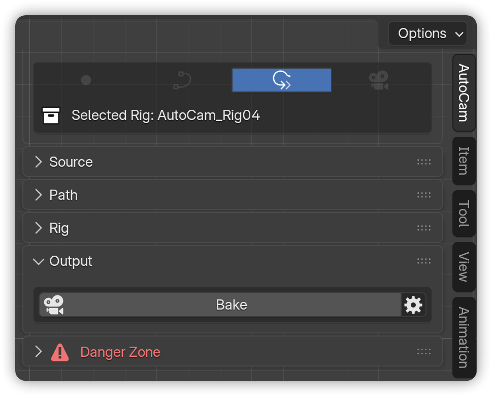
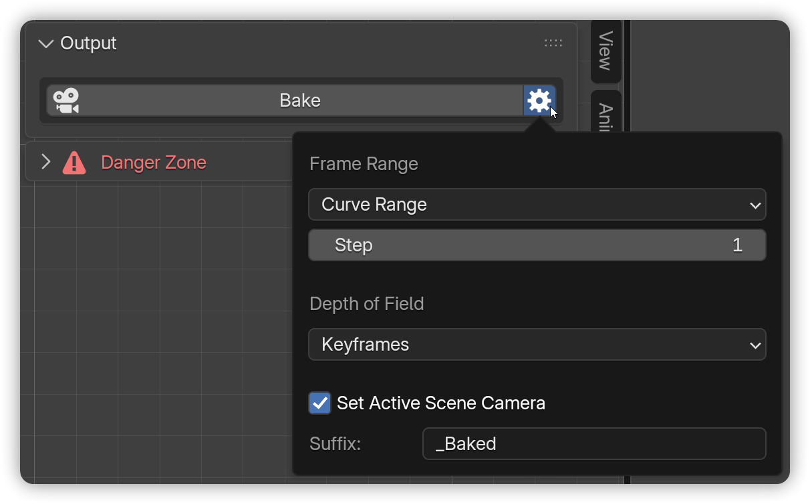
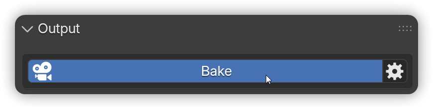
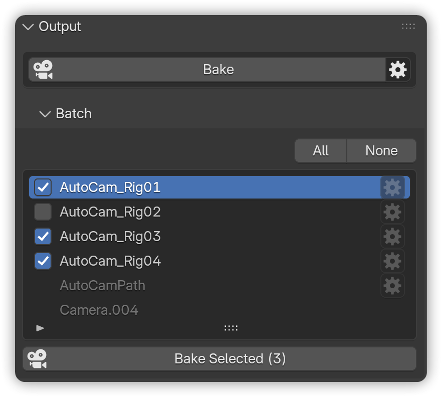
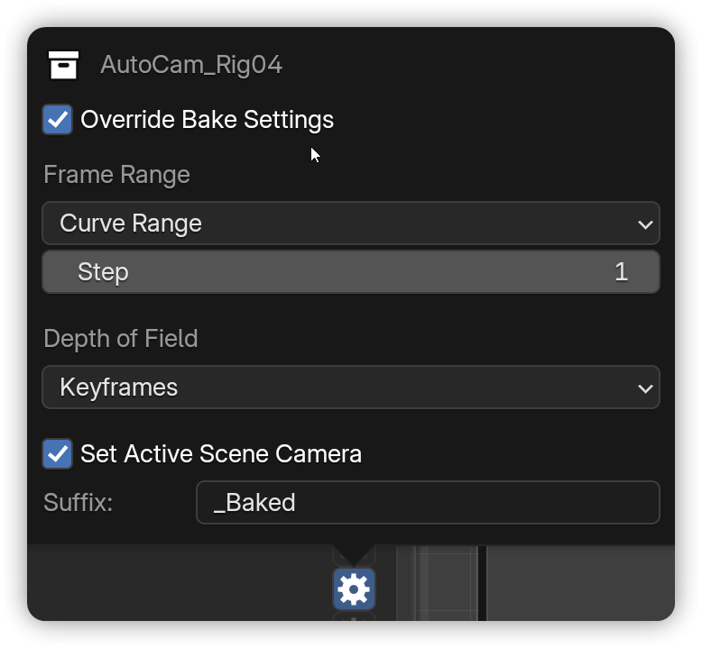
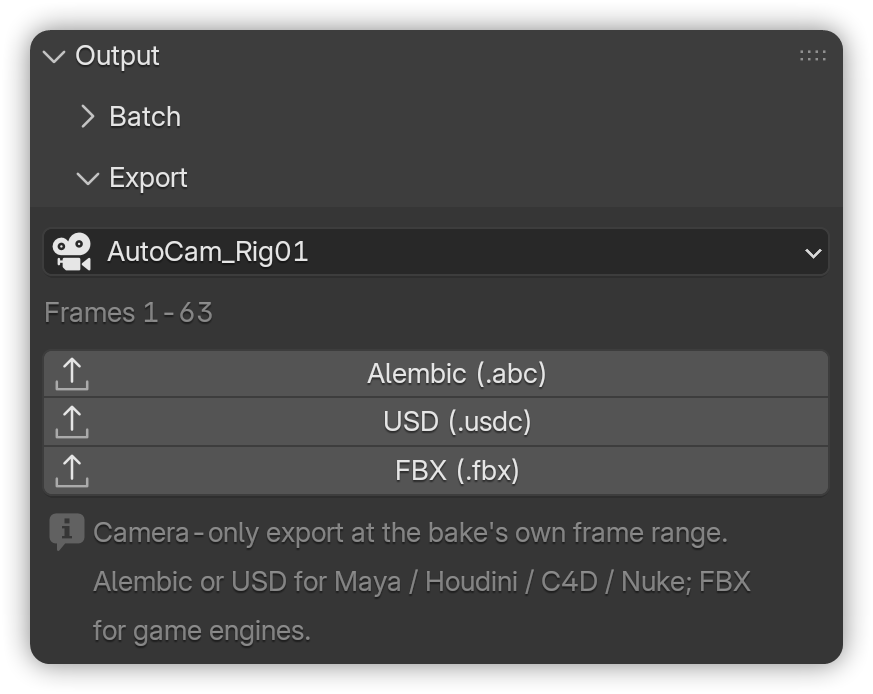

# Output

Baking transforms your AutoCam rig into standard keyframes on a Blender camera. This process makes the animation **independent of AutoCam**, ensuring consistent playback across different computers, render farms, or other digital content creation (DCC) tools.


**Note:** Requires an **AutoCam** **Rig**.



Anything marked <mark style="color:$warning;">**PRO**</mark> is an **AutoCam Pro** feature and is not present in a Free install.


***

### Bake the rig


**Prerequisites:**

* An **AutoCam** **Rig** is present.




In the 3D View, press **N** → open **AutoCam**.

<figure><figcaption></figcaption></figure>



Verify the header displays the correct rig, then click the <i class="fa-gear">:gear:</i> button beside the Bake button.

<figure><figcaption></figcaption></figure>



Configure your **Baking Settings**.

* **Frame Range:** Choose which frames to bake.
  * **Curve Range -** the rig/path span.
  * **Scene Range** - timeline start/end.
  * **Custom** - enter start/end frames.
* **Step:** Write keys every **N** frames.
  * **1** = Every frame (recommended for final).
  * **Higher values** = Fewer keys, but less precise motion/DoF.
* **Depth of Field:** Decide how focus is handled.
  * **Keyframes** - Bake FocusPoint into Focus Distance keys (export-safe).
  * **Use Focus Object** - Uses the original FocusPoint.
  * **Off** - Disable DoF entirely.
* **Set as active scene camera:** Make the newly baked camera the active render camera immediately.
* **Suffix:** Append text to the baked camera's name (e.g., `_Baked`) for easy identification.



Click on the **Bake button** to start the baking process.

<figure><figcaption></figcaption></figure>



A new **baked camera** is created. AutoCam controls hide for that camera.

<figure><figcaption></figcaption></figure>




Baking through AutoCam is **non-destructive** because the original rig collection remains intact. To revert, simply delete the "**\_Baked**" collection and reactivate the original.



**Setting your own defaults.** Every one of these settings can be seeded for new scenes from **Preferences → Bake Defaults**: **Range**, **Step**, **Depth of Field**, **Suffix**, and **Set Active Scene Camera**. (**Range** was added in 2.1.1 - it was the one bake setting with no default, so anyone who always bakes the scene range was re-picking it in every new file.)



<mark style="color:$warning;">**PRO**</mark> With [**Segments**](rig.md#segments-pro) in play, the bake range extends automatically to cover the whole sequence - you don't need to widen it by hand.


***

### When to bake <mark style="color:$info;">(quick checklist)</mark>

* You're sending to a **render farm** or sharing the file with someone **without AutoCam**.
* You're **exporting to another DCC** (FBX/Alembic/etc).
* You want a **locked, lightweight** camera you can tweak with vanilla keyframes.
* You want the shot immune to any later edit of the rig or its path.
* You're handing a **Pro-built** file to someone on **Free** - a baked camera is plain keyframes and needs no add-on at all.

***

### Re-Bake

Once a rig has been baked, the **Bake** button becomes **Re-Bake**.

<figure><figcaption></figcaption></figure>

It runs the bake again with your current settings and supersedes the previous baked camera.

Use it when you've changed the Progress timing, adjusted Tracking, or just want a different Step or Depth of Field setting on the output.

***

### Batch Bake <mark style="color:$warning;">**PRO**</mark>

Bake every rig in the scene in one click - and give any rig its own settings.

<figure><figcaption></figcaption></figure>

**Batch** is a sub-panel under Output. It appears once **two or more rigs** exist and at least one has reached the Rig stage.

* **All** / **None** in the header check or clear every row at once.
* Each row has an **include checkbox**, the rig's name, and a **gear popover** - _Rig Bake Settings_.
* **Bake Selected (N)** at the bottom counts the bakeable checked rigs and runs them. Skips and failures are reported per rig, so a single problem rig doesn't silently take the batch down with it.

#### Per-rig overrides

Open a row's gear and tick **Override Bake Settings**. That rig then bakes with its **own** frame range, step, depth of field and suffix, instead of the scene-wide Bake Settings.

<figure><figcaption></figcaption></figure>

Useful when one shot needs every frame and the rest are fine on step 2, or when one camera wants DoF baked to keyframes and another wants it off.

***

### Export <mark style="color:$warning;">**PRO**</mark>

Hand the finished camera to any pipeline - three buttons, no settings to get wrong.

<figure><figcaption></figcaption></figure>

**Export** is a sub-panel under Output. It works on the selected **baked** camera; when several exist, a **Target** dropdown picks one. A dimmed row above the buttons shows exactly what will be written: _Frames f0-f1_.

| Button             | Use it for                        |
| ------------------ | --------------------------------- |
| **Alembic (.abc)** | Maya, Houdini, Cinema 4D, Nuke    |
| **USD (.usdc)**    | USD pipelines, Omniverse, Solaris |
| **FBX (.fbx)**     | Game engines (Unreal, Unity)      |

The export is **scoped to the camera only**, at the **bake's own frame range** - never the scene range, and never the rest of your scene. The default filename is the camera's name, saved beside your `.blend`.


**FBX needs Blender's built-in "FBX format" add-on enabled.** If it isn't, the error message says so. Enable it in **Edit → Preferences → Add-ons**.



**Not in 1.0.0:** Batch export. Exports are one camera at a time; "Export Selected → folder" is on the [**Roadmap**](../../updates/roadmap.md).


***

### Common Issues <mark style="color:$info;">(and quick fixes)</mark>

* _"DoF missing or wrong on the baked camera"_ - You chose **Use Focus Object** or **Off**. Re-bake with **Depth of Field** → **Keyframes** (export-safe).
* _"Controls disappeared"_ - You're looking at the **baked** camera. Select the **original rig** to show controls.
* _"Export doesn't match preview"_ - Always export the **baked** camera, not the camera inside the rig collection.
* _"I deleted the rig and the baked camera went with it"_ - That's **Clear This Rig** working as intended: it takes the bake down first, then the rig. Bake again from a rebuilt rig, or keep the baked camera by moving it out of its collection first.
* _"My bake suffix got cut short"_ - Fixed in 2.1.1. Preferences accepted 64 characters where the scene setting accepted 32, so a long suffix was silently truncated on its way across.
* <mark style="color:$warning;">**PRO**</mark> _"The Batch tab isn't there"_ - It needs at least **two rigs**, with at least one at the Rig stage.
* <mark style="color:$warning;">**PRO**</mark> _"FBX export fails"_ - Enable Blender's built-in **FBX format** add-on.


Learn more about [**Panel States**](ui-overview.md#panel-states) to understand how it changes based on the context.


***

### Next steps

* See practical examples → [**Guides**](../guides.md)
* Or jump back to [**Quick Start**](../../welcome/quick-start.md) to see the whole workflow.

&#x20;&#x20;
