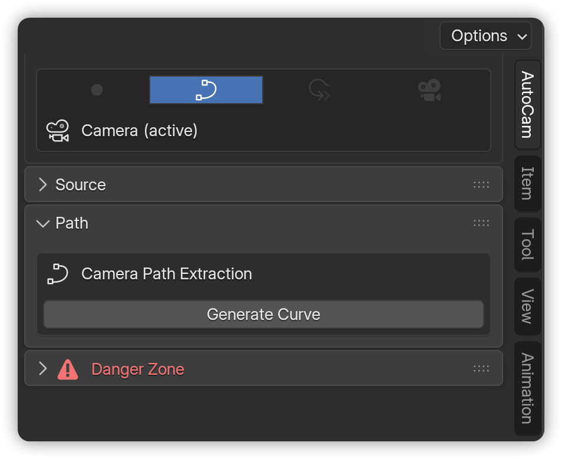
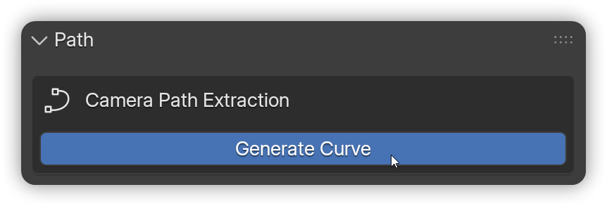
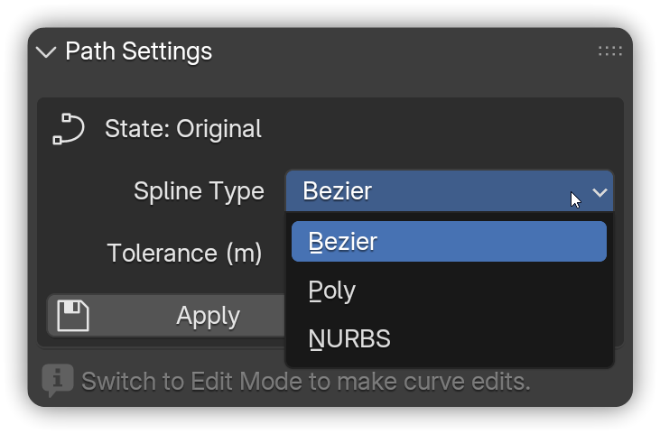
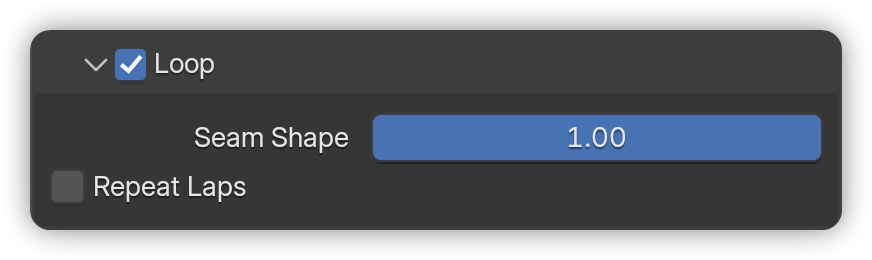
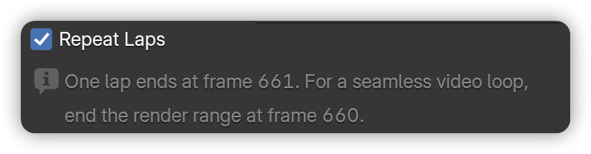
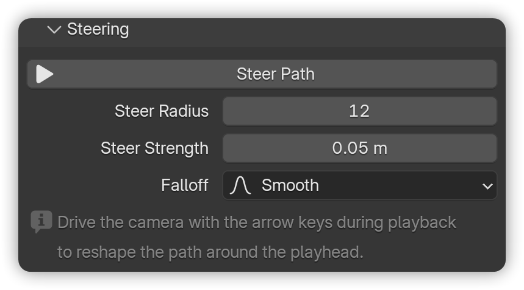
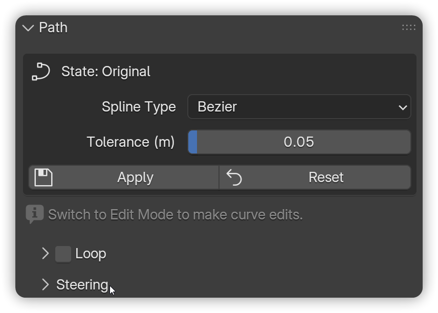
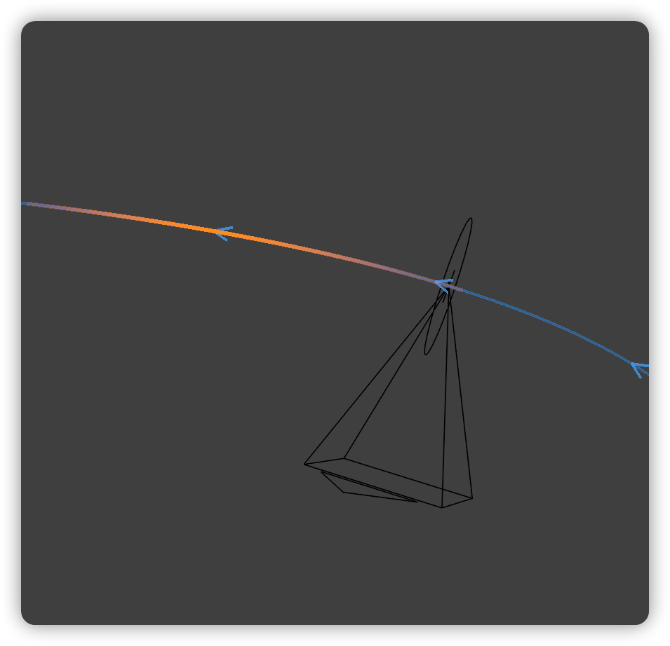

# Path

Convert your recorded camera movements into an **editable curve**, serving as the backbone for your AutoCam rig. You can select the spline type, adjust tolerance, and refine points in Edit Mode both before and after generating the rig.


**Note:** Requires a camera with **location keyframes**, either recorded or manually animated.



Anything marked <mark style="color:$warning;">**PRO**</mark> is an **AutoCam Pro** feature and is not present in a Free install.


***

### Path Extraction


**Prerequisites:**

* A camera **with location keyframes** exists (see [**Source**](source.md) if not).
* Ensure the camera is **selected**, regardless of whether it is active or inactive.




In the 3D View, press **N** → open **AutoCam**.

<figure><figcaption></figcaption></figure>



Select the **animated camera** → click **Generate Curve**.

<figure><figcaption></figcaption></figure>



Pick a **Spline Type**:

* **Bezier** → Smooth, familiar handles.
* **Poly** → Straight segments, snappy movement.
* **NURBS** → Very smooth with minimal points.


Click **Apply** to see your changes.


<figure><figcaption></figcaption></figure>



Adjust **Tolerance** to simplify the curve. Higher values = fewer points.


Click **Apply** to see your changes.


<figure><figcaption></figcaption></figure>



Use **Edit Mode** to adjust points or reshape the curve entirely.


Click **Apply** to see your changes.


<figure><figcaption></figcaption></figure>




**Note:** Always **press Apply while still in Edit Mode** (if you've changed the curve points).

* **Apply** (Edit Mode) → Apply saves your edits and updates the curve sample.
* **Apply** (Object Mode) → Apply ignores your edits and restores the original curve.
* **Reset** (Any Mode) → Fully restores the curve to its original shape based on the set **Tolerance** level.

Once you click **Apply** in Edit Mode, that version becomes your **new baseline**. Lowering the Tolerance afterwards won't bring back the detail that's already been removed.



**Tip:** Under **Path Settings**, the **State** indicator shows which sample you're editing:

* **Original**: You haven't applied any edits yet. Curve is using the original samples.
* **Edited**: You have applied edits in Edit Mode. Curve is using the updated samples.



<mark style="color:$warning;">**PRO**</mark> **If the rig is using** [**Inherit Original Speed**](rig.md#inherit-original-speed-pro), the Path panel warns in red before you reshape the curve:

> _Warning: Editing the curve will break inherited timing. Consider clearing inherited timing first._

Inherited timing is measured against the path you inherited from. Change the path and the two no longer agree. Either clear it first, or re-inherit afterwards - it's one click.


***

### Loop <mark style="color:$warning;">**PRO**</mark>

Close any path into a seamless cycle - turntables, idle loops, endless corridor runs. Loop is a sub-panel under **Path**; tick the checkbox in its header to enable it.

<figure><figcaption></figcaption></figure>

| Control                                                                                          | What it does                                                                                                    |
| ------------------------------------------------------------------------------------------------ | --------------------------------------------------------------------------------------------------------------- |
| **Seam Shape**                                                                                   | −1 to +1. **−1** curls inward (concave), **0** bridges straight, **+1** follows the path's momentum (seamless). |
| <ul class="contains-task-list"><li><input type="checkbox"><strong>Repeat Laps</strong></li></ul> | Appears once a rig exists. The camera keeps lapping past the last Progress key, indefinitely.                   |

The seam is a **derived bridge**, never baked into your curve. Toggle Loop off and the open path comes back exactly as it was. It works with all three spline types.

#### Getting a genuinely seamless render

The panel computes the exact loop point for you:

<figure><figcaption></figcaption></figure>

That **−1** is the whole trick. Frame N is identical to frame 1, so rendering it gives you a duplicate frame and a visible stutter at the wrap. **End on N−1 instead**.


**Loop interlocks with other Pro features:**

* [**Inherit Original Speed**](rig.md#inherit-original-speed-pro) re-normalises timing against the closed length and blends exit → entry speed across the seam, so the wrap is velocity-continuous.
* [**Path Lookahead**](rig.md#path-lookahead-pro) wraps its aim around the seam continuously instead of easing out at a path end.
* [**Segments**](rig.md#segments-pro) can cut away exactly at a lap boundary with **Snap Start to Lap End**.


***

### Realtime Path Steering <mark style="color:$warning;">**PRO**</mark>

Press play and _drive_ the path. Steering lets you bend the route live while the shot runs - like sculpting with proportional editing, but against the playhead. The entire session lands as a **single undo step**.

<figure><figcaption></figcaption></figure>

This is the tool for the take that came out 90% right.

Steering is a sub-panel under [**Path**](path.md).

<figure><figcaption></figcaption></figure>

#### Before you start

| Control            | Default | What it does                                                                              |
| ------------------ | ------- | ----------------------------------------------------------------------------------------- |
| **Steer Radius**   | 12      | How many frames either side of the playhead get bent.                                     |
| **Steer Strength** | 0.05    | How hard each nudge pushes.                                                               |
| **Falloff**        | Smooth  | Shape of the influence curve: **Smooth**, **Sphere**, **Root**, **Linear**, or **Sharp**. |

Click **Steer Path** to start. Playback begins and **loops** at the end of the range, so you can keep refining lap after lap.

#### Session controls

| Key                                              | Action                                                        |
| ------------------------------------------------ | ------------------------------------------------------------- |
| **Arrow keys**                                   | Steer left / right / up / down (screen-relative)              |
| **Fly keys** (W/S/A/D/E/Q, or your own bindings) | Push/pull depth, lateral, climb/dive                          |
| **C** (hold)                                     | Smooth the section under the falloff window                   |
| **V** (hold)                                     | Straighten it toward a flat chord                             |
| **F**                                            | Cycle the falloff shape                                       |
| **Space**                                        | Pause / resume. Pausing recenters, so you can sculpt in place |
| **Shift** (hold)                                 | Slow motion (¼ speed)                                         |
| **Ctrl + Scroll**                                | Grow / shrink the radius                                      |
| **Enter** or **Left Click**                      | Apply                                                         |
| **Esc** or **Right Click**                       | Cancel - the path is restored exactly                         |

An orange overlay tints the bendable window around the playhead, and a status bar lists every control while the session runs.

<figure><figcaption></figcaption></figure>


**Tip:** The movement keys are the same ones you fly with. Rebind them in **Preferences → Flythrough Controls** and Steering follows.



**Notes:**

* Steering needs an actual **3D Viewport** - it won't start without one.
* It works from **Edit Mode** too.
* The plain mouse wheel still zooms the viewport; only **Ctrl + Scroll** is claimed by the session.
* If the rig uses inherited timing, the session ends with _"Path changed - inherited timing is now approximate; re-inherit to refresh it."_ Re-inheriting is one click.


***

### Common Issues <mark style="color:$info;">(and quick fixes)</mark>

* _"Generate Curve is greyed out"_ - The selected camera has no **location** keyframes. Record or keyframe it manually.
* _"My edits vanished after Apply"_ - You clicked **Apply** in Object Mode. Re-edit and **Apply in Edit Mode** to update the sample.
* <mark style="color:$warning;">**PRO**</mark> _"Steer Path does nothing / won't start"_ - The operator needs a 3D Viewport in the current screen layout.
* <mark style="color:$warning;">**PRO**</mark> _"My loop has a hitch at the wrap"_ - End the render range at **one frame before** the lap end the Loop panel reports.
* <mark style="color:$warning;">**PRO**</mark> _"Timing drifted after I reshaped the path"_ - Inherited timing was measured against the old path. Click **Inherit Original Speed** again.


Learn more about [**Panel States**](ui-overview.md#panel-states) to understand how it changes based on the context.


***

### Next steps

* Drive the path with a rig → [**Rig**](rig.md)
* Or jump back to [**Quick Start**](../../welcome/quick-start.md) to see the whole workflow.

&#x20;&#x20;
