# Rig

Create a versatile camera rig in a single click to follow your extracted path. Time the move by keyframing **Progress**, and control where the camera looks with **Tracking**.


**Note:** Requires an **AutoCam** **Path** object



Anything marked <mark style="color:$warning;">**PRO**</mark> is an **AutoCam Pro** feature and is not present in a Free install.


***

### Rig Generation


**Prerequisites:**

* An **AutoCam curve** is present (see [**Path**](path.md)).
* Select the **curve**. The **Rig** panel will appear.




In the 3D View, press **N** → open **AutoCam**.

<figure>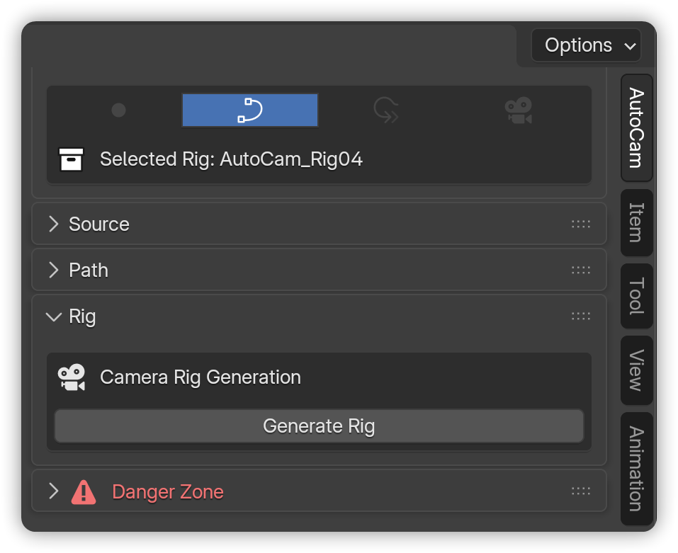<figcaption></figcaption></figure>



Make sure the **AutoCam path** is selected → click **Generate Rig**.

<figure>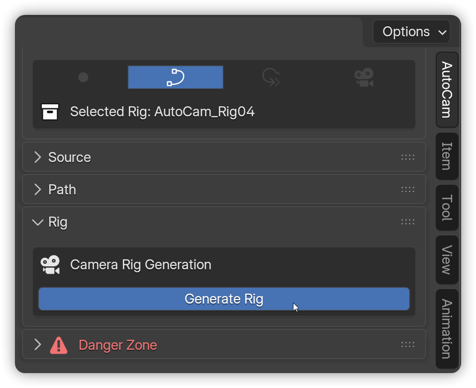<figcaption></figcaption></figure>



Press **Play** on the Timeline to preview.

<figure><figcaption></figcaption></figure>



AutoCam leaves the **Aim** target selected when the rig is built, so the first move you make is the one that points the camera.

<figure>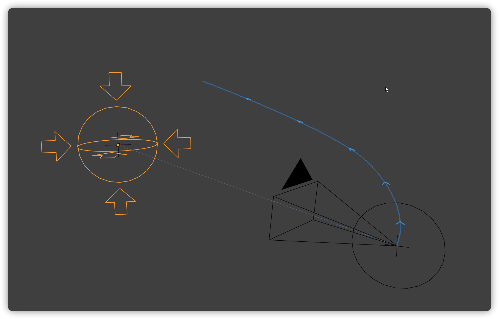<figcaption></figcaption></figure>

***

### Anatomy of the rig

Generate Rig builds five objects, shaped and colour-coded by role. Each handle is a picture of its job.

| Object         | Looks like                                                                           | What it's for                                                                                                                                                                       |
| -------------- | ------------------------------------------------------------------------------------ | ----------------------------------------------------------------------------------------------------------------------------------------------------------------------------------- |
| **Aim**        | 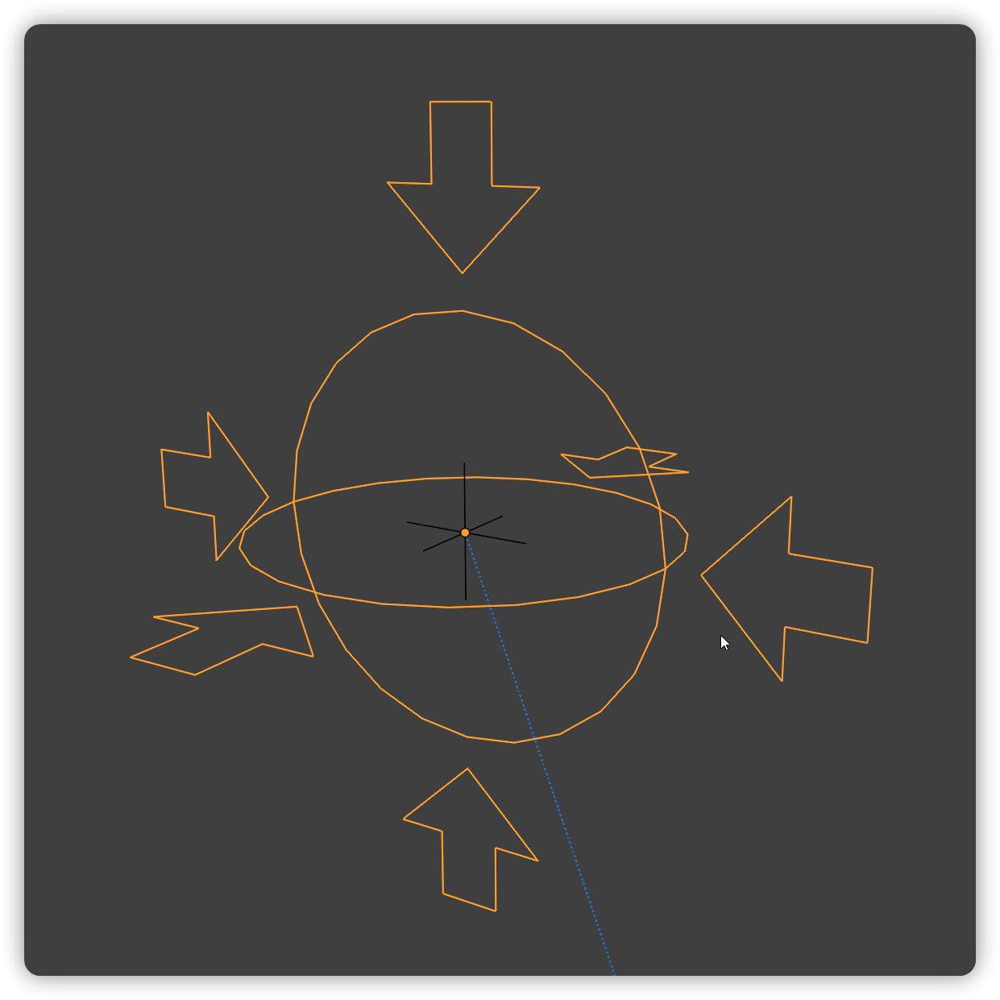 | **The handle you grab.** It's the aim target - the camera points at it. Every tracking mode ultimately moves or constrains this one object, and it stays selectable in all of them. |
| **FocusPoint** | 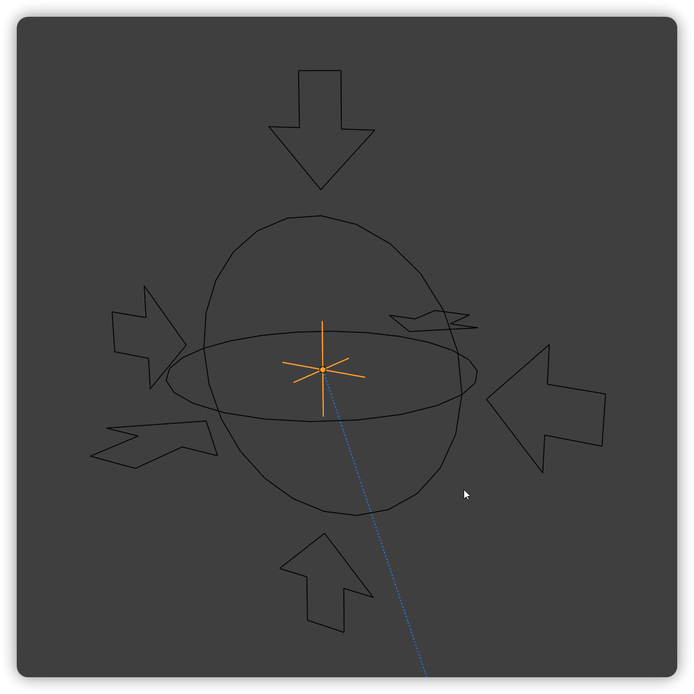                                            | The point that is sharp. Bound as the camera's Depth of Field focus object, and parented to the Aim so it follows by default.                                                       |
| **Dolly**      | 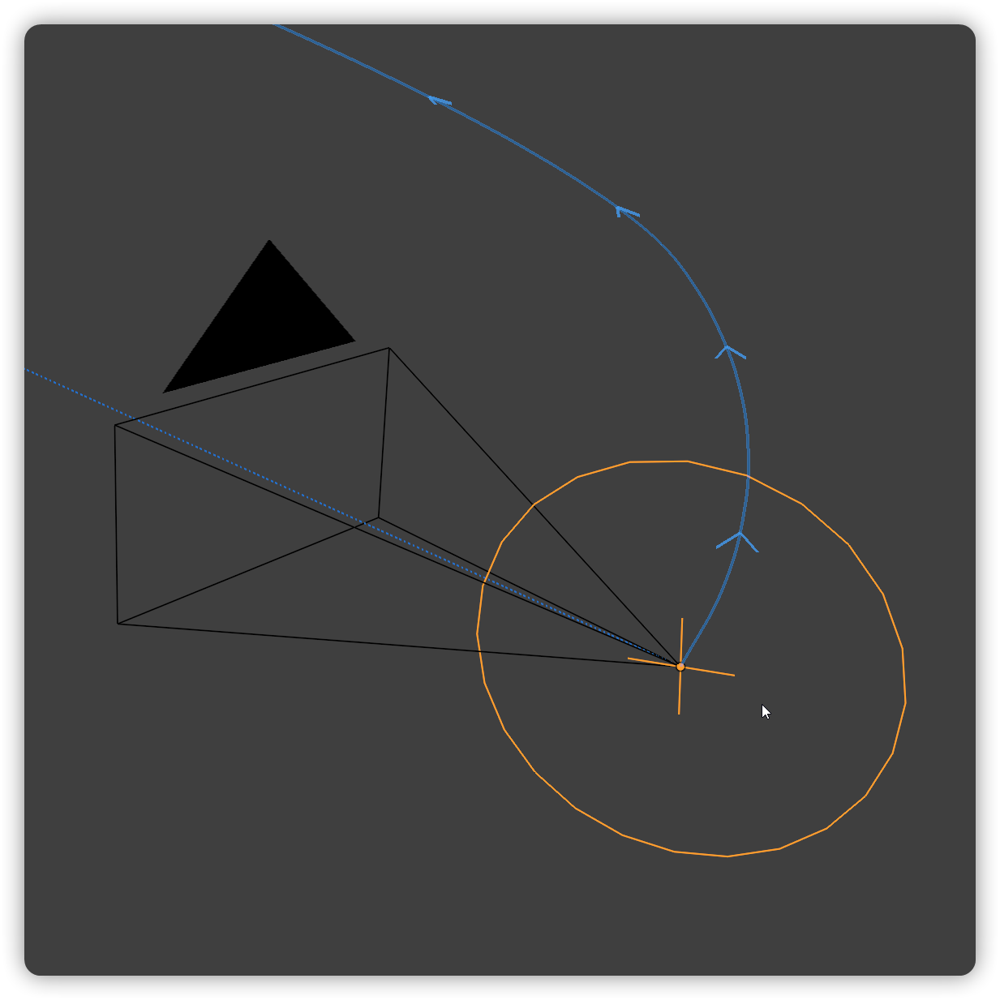                                    | The carriage. It rides the curve on a Follow Path constraint, and its offset **is** the Progress slider.                                                                            |
| **Camera**     | 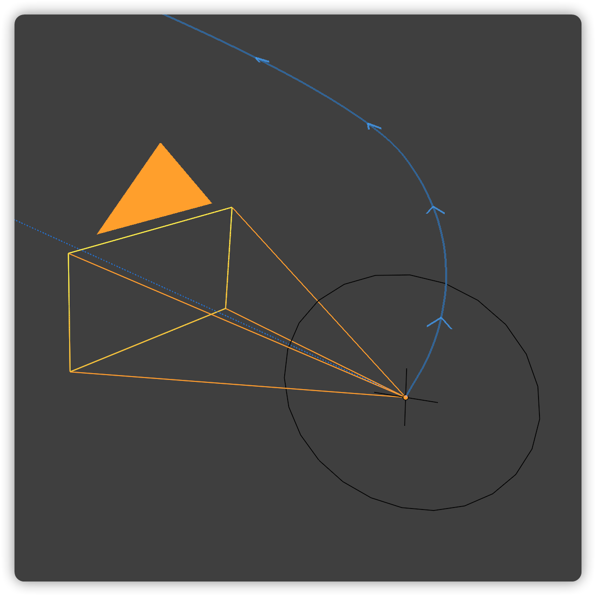                                            | A copy of your original. The source camera is hidden, never destroyed.                                                                                                              |
| **Gimbal**     | Not drawn                                                                            | The pivot that carries the Track To constraint. See below.                                                                                                                          |


**Renamed in 2.1.1.** The object you drag used to be called **LookAt** and is now **Aim**; the pivot behind it used to be called **Aim** and is now **Gimbal**. Testers kept dragging the pivot precisely because it was the one called "Aim". Rigs built in 2.1.0 or earlier keep their old names and keep working - AutoCam recognises both layouts. Rebuild with **Generate Rig** to pick up the new names and shapes.


#### About the Gimbal

The Gimbal isn't drawn, because it shares a world position with the Dolly and the camera and a third marker there only ever gave you a wrong thing to grab. It's still a real control, and still **selectable from the Outliner**.

It's worth knowing what it does: the Track To is computed **from the Gimbal's origin**. So nudging the Gimbal is how you boom the camera off its path while keeping the aim exact.

Moving the **camera** instead only looks similar. The camera then aims _parallel_ to the target rather than _at_ it, and the error grows with the offset - around 7.6° at 1.7 m, 21.8° at 4.5 m.


**The dashed line from the camera to the Aim** is Blender's own relationship line for the Track To constraint. Hide it with the stock **Overlays → Relationship Lines** if it's in the way.


#### Handle sizing

Handles are sized against the path, with the Aim deliberately the largest since it's the one you reach for, and the Dolly sized against the camera it rides with - a collar around the cone rather than a hoop around the shot. The Aim is also sized from its distance to the camera, so a shot that aims at a far wall doesn't leave you hunting for a speck.

If the default is too large or too small for your scene, **Rig Scale** in **Preferences → Viewport** multiplies every handle. It applies to **every rig in the file the moment you move it**, not just to rigs you build afterwards.

***

### Rig Settings

#### Progress

**Progress** drives the camera along the curve. It is the Follow Path constraint's offset factor, surfaced on the Rig panel with a keyframe decorator beside it.

* **0.0** — the start of the path
* **1.0** — the end of the path

Timing is authored as plain keyframes on this one value. There is no separate speed setting.



Go to the frame the move should start on → set **Progress** to **0** → click the keyframe dot beside the slider.



Go to the frame it should end on → set **Progress** to **1** → keyframe again.



Press **Play**. The camera travels the path between those two keys.



**Shaping the move:**

| You want                | Do this                                                                   |
| ----------------------- | ------------------------------------------------------------------------- |
| Faster / slower overall | Drag the last Progress key earlier or later                               |
| Ease in / out           | Set the Progress keys to Bezier and shape the handles in the Graph Editor |
| Hold in place           | Two neighbouring keys with the **same** Progress value                    |
| Reverse                 | A later key with a **lower** value than the one before it                 |
| Only part of the path   | Key from e.g. **0.25 → 0.60** instead of 0 → 1                            |


**Tip:** To finish on an exact frame, just drag the last **Progress** keyframe to that frame. No recalculation needed.


#### Viewport display

**Show Path Direction** draws the path as a soft accent line with chevrons pointing the way the camera travels, so you can read direction at a glance. It's a viewport overlay only - it never affects the animation, and it never draws for a baked camera.

<figure>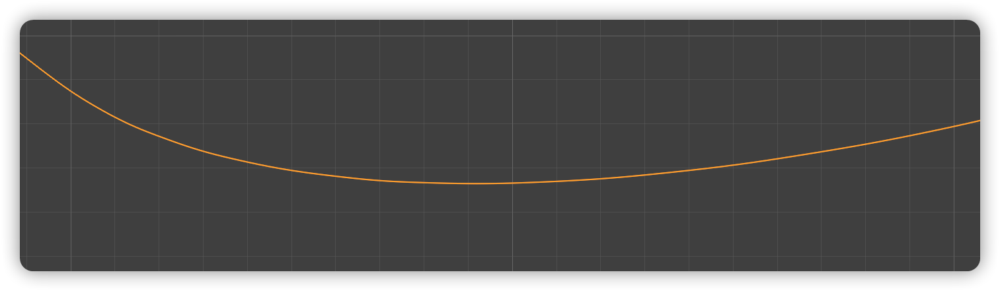<figcaption></figcaption></figure>

<figure>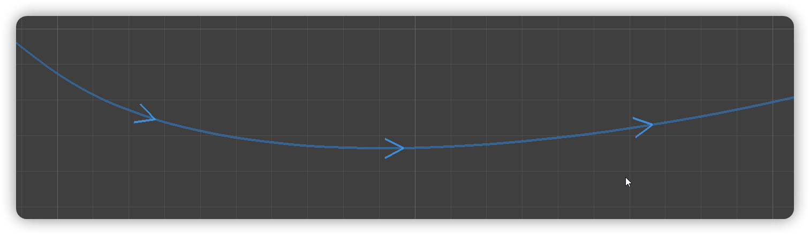<figcaption></figcaption></figure>


**Moved in 2.1.1.** This was a per-rig checkbox on the Rig panel; it now lives in **Preferences → Viewport** alongside **Rig Scale**, and it is **global**. It's a viewport display choice, and the Rig panel is for things that change the shot. If you were toggling it per rig, that distinction is gone.


***

### Inherit Original Speed <mark style="color:$warning;">**PRO**</mark>

One click makes the rig move exactly like you flew it - every hesitation, drift and acceleration - but on a clean, editable path.

<figure>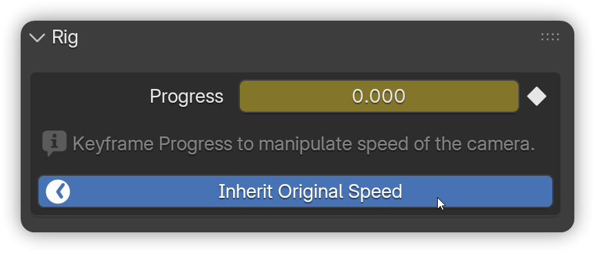<figcaption></figcaption></figure>

**Inherit Original Speed** writes one Progress key per frame, derived from the cumulative arc length of the **original recording** - the pre-simplification samples, so nothing of the performance is lost to the Tolerance you applied on the Path stage.

<figure>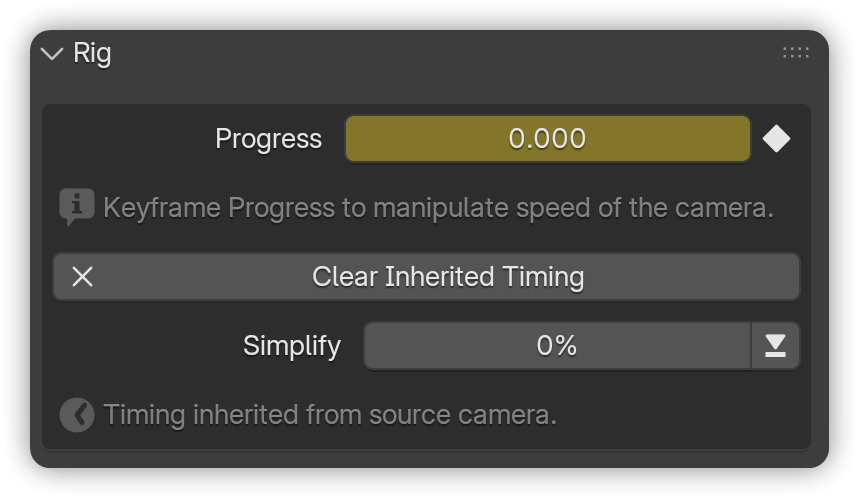<figcaption></figcaption></figure>

Once inherited, three controls appear:

| Control                                                                                          | What it does                                                                                     |
| ------------------------------------------------------------------------------------------------ | ------------------------------------------------------------------------------------------------ |
| **Clear Inherited Keys**                                                                         | Removes them and restores your previous hand-made Progress keys, if you had any. Confirms first. |
| **Simplify**                                                                                     | 0-100%, live. Thins the per-frame keys down to something hand-editable.                          |
| **Update Base** 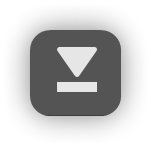 | Captures your hand-edited keys as the new base for Simplify.                                     |


**Loop-aware.** With **Loop** on, timing normalizes against the closed length and blends exit → entry speed across the seam, so the wrap is velocity-continuous.



**Editing the curve breaks the sync.** Inherited timing is measured against the path you inherited from:

* Reshaping the curve puts a red warning on the **Path** panel.
* A **Steering** session ends with _"Path changed - inherited timing is now approximate; re-inherit to refresh it."_

The fix is the same in both cases: click **Inherit Original Speed** again.



**Camera Morph** applies this automatically after the rig is built, so a declared-pose move is already timed correctly.


***

### Tracking

Control **where the camera looks** as it travels the path. Tracking is a sub-panel under Rig. It's collapsed by default; click to expand.

<figure>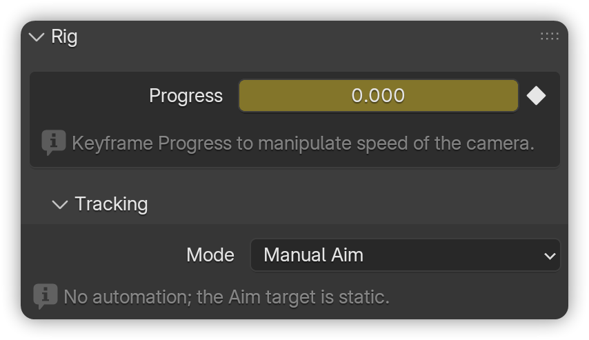<figcaption></figcaption></figure>

Whichever mode you choose, only the **Aim** is moved or constrained - which is why **Depth of Field keeps working in every mode**, with the FocusPoint riding along.

<figure>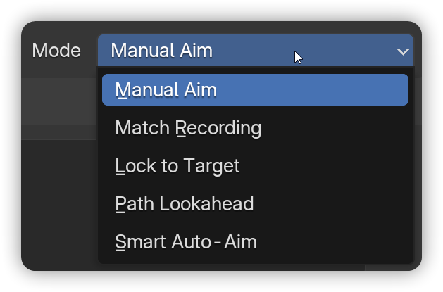<figcaption></figcaption></figure>

<strong>Manual Aim:</strong>

No automation. The camera points at the **Aim** target, and you place or animate it yourself.

<figure>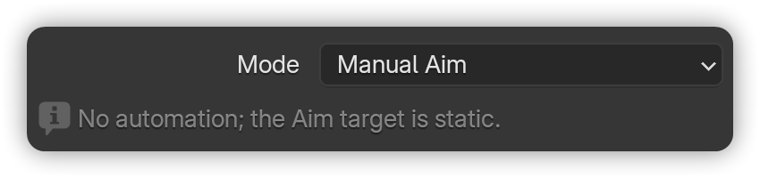<figcaption></figcaption></figure>

**Aim:**

Move the **Aim** handle - the azure ring with the inward arrows - onto your subject. Keyframe its position, or parent it to the subject, to steer the camera's aim.

**FocusPoint:**

A dedicated **FocusPoint** object, assigned to the camera's **Focus on Object** (under Depth of Field). You can position or animate it to control the focal distance.

By default the FocusPoint is **parented to the Aim**, so when the Aim moves, focus follows. You can still move or keyframe the FocusPoint independently for fine-tuned control of focus, even when the Aim stays fixed. It nests inside the Aim's ring and is selectable in its own right.

<strong>Match Recording:</strong>

Mutes the **Track To** constraint on the **Gimbal** and uses the camera's **recorded rotation keyframes** from your original camera animation. Position still comes from the path.

<figure>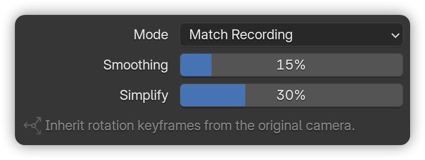<figcaption></figcaption></figure>

**Simplify:**

Sets the **tolerance** for removing tiny rotation keys.

**Higher values** allow more deviation → **fewer keys** (but too high can erase intended arcs).

**Smoothing:**

Applies a **Butterworth-style low-pass filter** to each rotation axis to reduce high-frequency jitter.

Higher = **smoother** but more softened direction changes.

<strong>Lock to Target: </strong><mark style="color:$warning;"><strong>PRO</strong></mark>

The camera watches one object, every frame - static or animated - and you can swap targets live, mid-shot, with no rebuild.

<figure>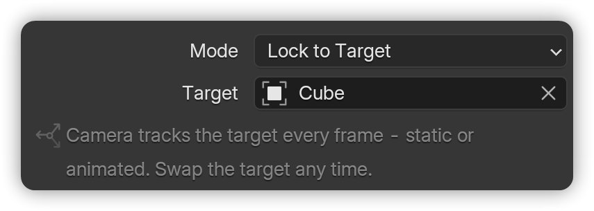<figcaption></figcaption></figure>

**Target:**

Pick any object in the scene. The picker excludes the rig's own pieces, so you can't accidentally aim at yourself.

Mechanically this is a Copy Location constraint on the **Aim**, so the Track To rig and the FocusPoint's DOF stay intact. With no target picked, the panel warns _"Pick a target object to lock onto."_ and the Aim simply holds its manual spot.

Works across all **Segments**.

<strong>Path Lookahead: </strong><mark style="color:$warning;"><strong>PRO</strong></mark>

The camera looks through the corner like a driver - it aims a set distance ahead along its own path, so bends steer smoothly instead of whipping.

<figure>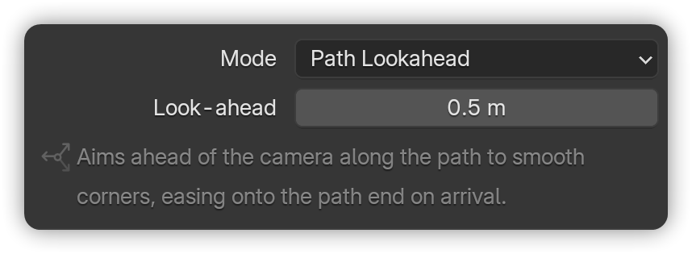<figcaption></figcaption></figure>

**Look-ahead:**

A distance along the path (default **0.5**, minimum 0.01). Small values are tight and reactive; large values are long and floaty.

On open paths the aim eases onto the path end on arrival. On **looped** paths it wraps around the seam continuously. Each **segment** gets its own lookahead with matching hand-off windows.

Best for corridor flythroughs, drone passes, and roller-coaster or vehicle energy.


This is the only Pro tracking mode that can be set as a **default** in **Preferences → Rig Defaults → Tracking**, so every rig you build can start out aiming down its path. Lock to Target needs a target object and Smart Auto-Aim needs a recording to resample - neither exists at the moment a rig is built.


<strong>Smart Auto-Aim: </strong><mark style="color:$warning;"><strong>PRO</strong></mark>

Your recording already says what you were looking at. Smart Auto-Aim reads it back frame by frame and turns it into a clean, smoothable aim.

<figure>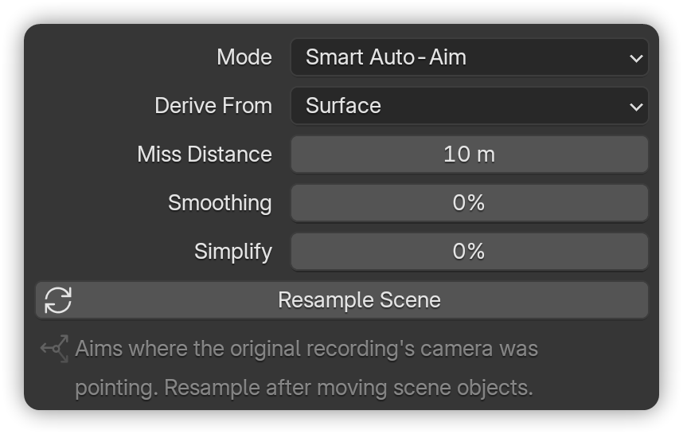<figcaption></figcaption></figure>

**Derive From:**

* **Surface** - aims at the scene geometry the recording was looking at. If a ray misses, it holds the last hit distance.
* **Fixed Distance** - projects the recorded view direction out to a set distance.

The distance field renames itself to match: **Miss Distance** in Surface mode, **Focal Distance** in Fixed Distance mode (default 10.0).

**Smoothing and Simplify:**

0–100%, same idea as Match Recording - reduce jitter, thin the keys.

**Resample Scene:**

Re-runs the raycast pass. Use it after scene objects have moved.


**The scene is sampled once and cached on the curve.** Dragging Smoothing or Simplify, or switching between Surface and Fixed Distance, re-derives the aim **instantly** - no timeline scrub, no re-raycast.


Only the Aim's location is keyed, so the rig and DOF stay intact. AutoCam reports what it did: _"Smart Auto-Aim: N frames sampled, N surface hits"_.

**Caveats:** it's derived from the rig's own recording, so on added **Segments** the aim holds its last pose. It does not live-track moving objects - that's Lock to Target's job.

***

### Segments <mark style="color:$warning;">**PRO**</mark>

One camera, many paths. Chain curves - recorded or hand-drawn - into a single move with hard cuts, like blocking a sequence.

<figure>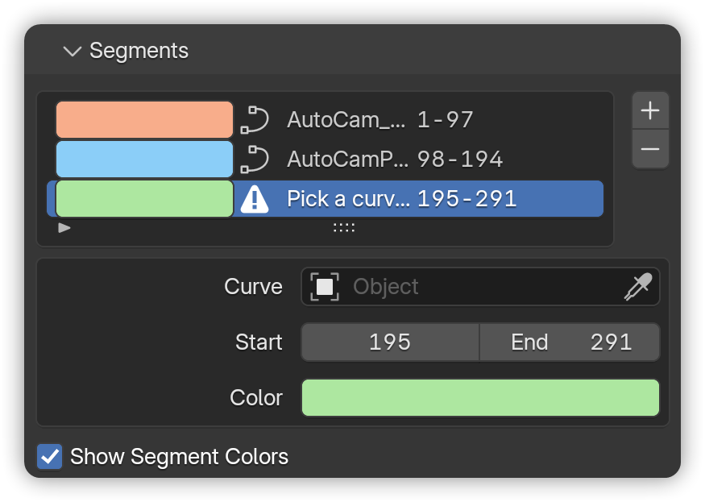<figcaption></figcaption></figure>

Segments is a sub-panel under **Rig**. Each row shows a color swatch, the curve's name, and its frame window. The rig's own path is always first - listed as **(rig path)**, read-only, and paced by Progress or Inherit Original Speed.

<figure>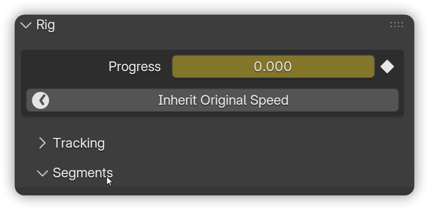<figcaption></figcaption></figure>

Click **+** to add a row and pick any curve object in the scene.

<figure>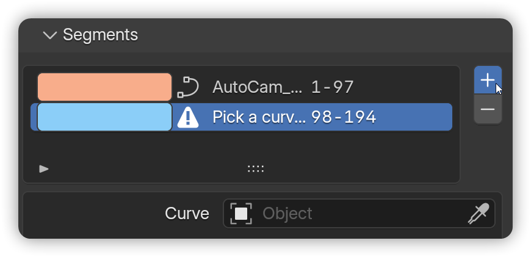<figcaption></figcaption></figure>

| Per-segment control                                                                                      | What it does                                                      |
| -------------------------------------------------------------------------------------------------------- | ----------------------------------------------------------------- |
| **Start** / **End**                                                                                      | The frame window this segment occupies.                           |
| **Color**                                                                                                | Its swatch in the viewport overlay.                               |
| <ul class="contains-task-list"><li><input type="checkbox" checked><strong>Repeat Laps</strong></li></ul> | How many times to lap this curve. Needs a cyclic or looped curve. |

#### Rules the panel enforces

* Segments run **in sequence**. No overlaps - a start clamps to the previous segment's end.
* **Gaps are legal.** The camera parks at the previous curve's end until the next hand-off.
* Transitions are **hard cuts** by design. There is no blended hand-off in 1.0.0.
* You'll get a warning if the sequence runs past the scene's end frame.

#### Snap Start to Lap End

When the previous segment is lapping, a **Snap Start to Lap End** button appears - it lines the cut up exactly with the loop seam, so the camera cuts away at the moment the lap closes rather than mid-lap. The panel lists the lap boundaries so you can pick one.

<figure>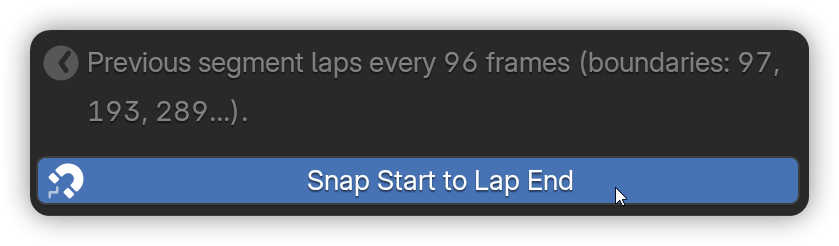<figcaption></figcaption></figure>

#### Show Segment Colors

A viewport overlay that tints each segment with its own colour from an eight-colour palette (coral, azure, green, amber, violet, teal, pink, grey), with the active segment emphasised.

<figure>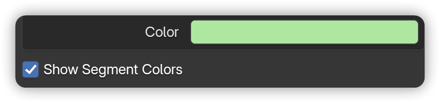<figcaption></figcaption></figure>


**Tracking caveat, shown in the panel:** _"This tracking mode is derived from the rig's own recording; on added segments the aim holds its last pose."_ That applies to **Match Recording** and **Smart Auto-Aim**. **Manual Aim**, **Lock to Target** and **Path Lookahead** work across all segments.



**Baking covers the whole sequence automatically** - The bake's frame range extends to the last segment's end. See [**Output**](output.md).


***

### Common Issues <mark style="color:$info;">(and quick fixes)</mark>

* _"No movement"_ - Check that you have at least **two Progress keyframes with different values**, and that the playhead sits between them. A single key (or two identical keys) holds the camera still by design.
* _"The camera finishes too early or too late"_ - Drag the last **Progress** key to the frame you want the move to end on.
* _"Aiming feels off"_ - Set **Tracking** to **Manual Aim**, then position or keyframe the **Aim** handle yourself.
* _"Where did the LookAt object go?"_ - It's called **Aim** from 2.1.1 onward, and the old pivot named "Aim" is now **Gimbal**. Existing rigs keep their old names; rebuild to adopt the new ones.
* _"The rig handles are huge / tiny"_ - Adjust **Rig Scale** in **Preferences → Viewport**. It applies to every rig in the file immediately.
* _"The path line and chevrons are in the way"_ - Untick **Show Path Direction** in **Preferences → Viewport** (it moved there in 2.1.1).
* _"The camera drifts off-target when I move it off the path"_ - Move the **Gimbal** instead of the camera. The Track To is computed from the Gimbal's origin, so offsetting it keeps the aim exact.
* <mark style="color:$warning;">**PRO**</mark> _"Inherited timing looks wrong after editing the path"_ - Click **Inherit Original Speed** again to re-sync.
* <mark style="color:$warning;">**PRO**</mark> _"The aim freezes on my second segment"_ - Match Recording and Smart Auto-Aim only know about the rig's own recording. Switch to Manual Aim, Lock to Target, or Path Lookahead.


Learn more about [**Panel States**](ui-overview.md#panel-states) to understand how it changes based on the context.


***

### Next steps

* Lock in the result for rendering/export → [**Output**](output.md)
* Remove this rig and its bake without touching the rest of the scene → **Clear This Rig** in the [**Danger Zone**](ui-overview.md#danger-zone-panel).
* See common workflows → [**Guides**](../guides.md)
* Or jump back to [**Quick Start**](../../welcome/quick-start.md) to see the whole workflow.

&#x20;&#x20;
