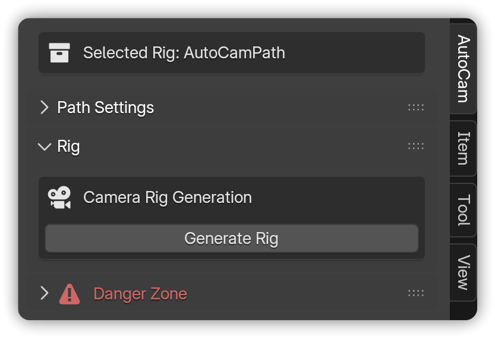
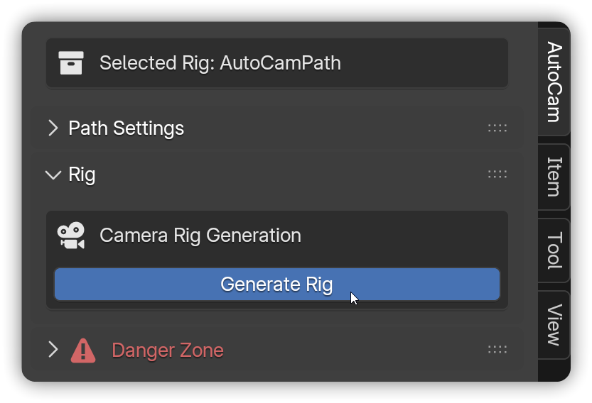

# Rig

Create a versatile camera rig in a single click to follow your extracted path. Time the move by keyframing **Progress**, and control where the camera looks with **Tracking**.

<figure><figcaption></figcaption></figure>


**Note:** Requires an **AutoCam** [**Path**](path.md) object


***

## Rig Generation


**Prerequisites:**

* An **AutoCam curve** is present (see [**Path**](path.md)).
* Select the **curve**. The **Rig** panel will appear.




In the 3D View, press **N** → open **AutoCam**.

<figure><figcaption></figcaption></figure>




Make sure the **AutoCam path** is selected → click **Generate Rig**.

<figure><figcaption></figcaption></figure>




Press **Play** on the Timeline to preview.

<figure><figcaption></figcaption></figure>



***

## Rig Settings

Adjust parameters such as speed and tracking preferences to tailor your AutoCam rig's behavior.

### Progress

**Progress** drives the camera along the curve. It is the Follow Path constraint's offset factor, surfaced on the Rig panel with a keyframe decorator beside it.

* **0.0** — the start of the path
* **1.0** — the end of the path

Timing is authored as plain keyframes on this one value. There is no separate speed setting.



Go to the frame the move should start on → set **Progress** to **0** → click the keyframe dot beside the slider.



Go to the frame it should end on → set **Progress** to **1** → keyframe again.



Press **Play**. The camera travels the path between those two keys.



**Shaping the move:**

| You want                | Do this                                                                   |
| ----------------------- | ------------------------------------------------------------------------- |
| Faster / slower overall | Drag the last Progress key earlier or later                               |
| Ease in / out           | Set the Progress keys to Bezier and shape the handles in the Graph Editor |
| Hold in place           | Two neighbouring keys with the **same** Progress value                    |
| Reverse                 | A later key with a **lower** value than the one before it                 |
| Only part of the path   | Key from e.g. **0.25 → 0.60** instead of 0 → 1                            |


**Tip:** To finish on an exact frame, just drag the last **Progress** keyframe to that frame. No recalculation needed.


### Show Path Direction

A per-rig checkbox on the **Rig** panel. It draws the path as a soft accent line with chevrons pointing the way the camera travels, so you can read direction at a glance.

This is a viewport overlay only — it never affects the animation, and it never draws for a baked camera.

### Tracking

Control **where the camera looks** as it travels the path. Tracking is a sub-panel under Rig. It's collapsed by default; click to expand.

<strong>Manual Aim:</strong>

The "**\_Aim**" object (and consequently the camera) actively follows the "**\_LookAt**"  object with no tracking automation. The LookAt object needs to be placed or animated manually.

<figure><figcaption></figcaption></figure>

#### **LookAt:**

Move the spherical **LookAt** empty onto your subject. Keyframe its position (or parent it to the subject) to steer the camera’s aim.

#### **FocusPoint:**

A dedicated **FocusPoint** object, assigned to the camera’s **Focus on Object** (under Depth of Field). You can position or animate it to control the focal distance.

By default, the FocusPoint is **parented to the LookAt**, so when the LookAt moves, the FocusPoint follows. However, you can still move or keyframe the FocusPoint independently for fine-tuned control of focus, even when the LookAt stays fixed.

<strong>Match Recording:</strong>

Mutes the **Track To** object constraint on the "**\_Aim**" object and uses the camera’s **recorded rotation keyframes** from your original camera animation. Position still comes from the path.

<figure><figcaption></figcaption></figure>

#### **Simplify:**

Sets the **tolerance** for removing tiny rotation keys.

**Higher values** allow more deviation → **fewer keys** (but too high can erase intended arcs).

#### **Smoothing:**

Applies a **Butterworth-style low-pass filter** to each rotation axis to reduce high-frequency jitter.

Higher = **smoother** but more softened direction changes.

***

## Common Issues <mark style="color:$info;">(and quick fixes)</mark>

* _"No movement"_ - Check that you have at least **two Progress keyframes with different values**, and that the playhead sits between them. A single key (or two identical keys) holds the camera still by design.
* _"The camera finishes too early or too late"_ - Drag the last **Progress** key to the frame you want the move to end on.
* _"Aiming feels off"_ - Set **Tracking** to **Manual Aim**, then position or keyframe the **LookAt** empty yourself.
* _"The path line and chevrons are in the way"_ - Untick **Show Path Direction** on the Rig panel.


Learn more about [**Panel States**](ui-overview.md#panel-states) to understand how it changes based on the context.


***

## Next steps

* Lock in the result for rendering/export → [**Output**](output.md)
* Remove this rig and its bake without touching the rest of the scene → **Clear This Rig** in the [**Danger Zone**](ui-overview.md#danger-zone-panel).
* See common workflows → [**Guides**](../guides.md)
* Or jump back to [**Quick Start**](../../welcome/quick-start.md) to see the whole workflow.

&#x20;&#x20;
