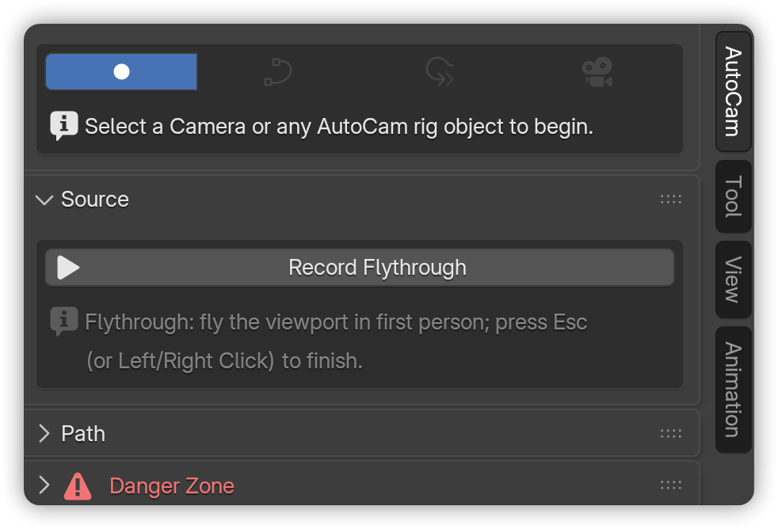
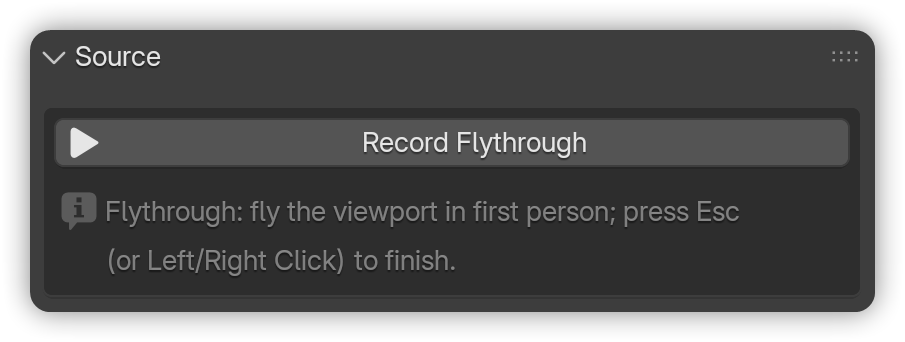
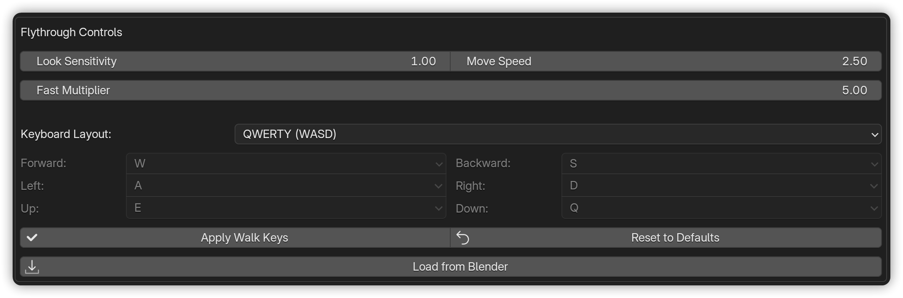
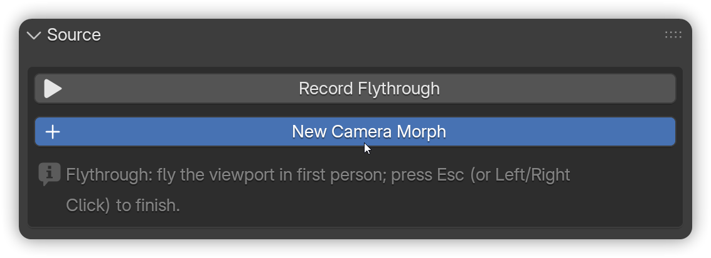
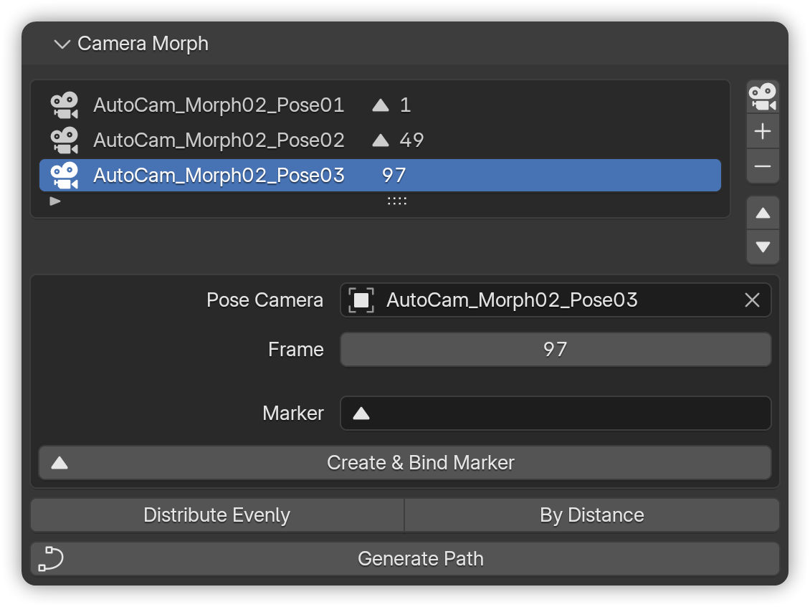
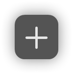
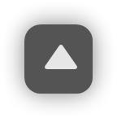
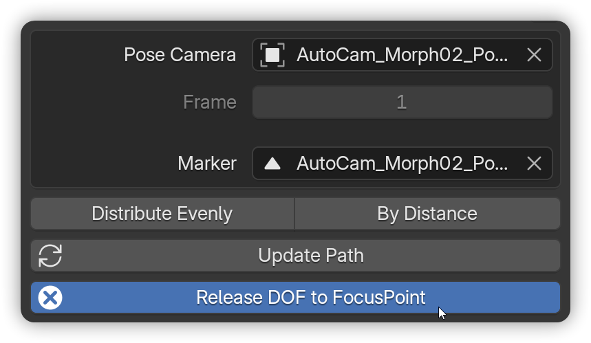

# Source

Fly through your scene like a video game, and AutoCam captures that motion as keyframes on your camera. This rough animation becomes the foundation for the AutoCam path and camera rig.

**Source** is also where AutoCam shows the origin of an existing rig. Select any AutoCam object and the panel names the camera the motion came from.


**Note:** Recording is optional. If your camera already has location keyframes, you can skip ahead to [**Path**](path.md)**.**



Anything marked <mark style="color:$warning;">**PRO**</mark> is an **AutoCam Pro** feature and is not present in a Free install.


***

### Start a recording


**Prerequisites:**

* A **Camera** exists in the scene (**Shift + A** → **Camera**).
* It's set as the **active scene camera** (**Make Active** in the AutoCam panel header).




In the 3D View, press **N** → open **AutoCam**.

<figure><figcaption></figcaption></figure>



Click **Record Flythrough**.

<figure><figcaption></figcaption></figure>



**Fly like a game** ([see controls](source.md#default-controls)).

<figure><figcaption></figcaption></figure>



Press **Esc** or **Left/Right Mouse Click** to finish.

<figure><figcaption></figcaption></figure>




**Note:** Recording always uses the **active scene camera,** regardless of the selected camera.



**Note:** Recording again on the same camera **clears its previous animation** first. If the recording runs past the end of the timeline, AutoCam extends the range temporarily so the take isn't cut off.


***

### Default controls

| Action                  | Keys/Mouse                                  |
| ----------------------- | ------------------------------------------- |
| Forward / Back          | **W / S**                                   |
| Left / Right            | **A / D**                                   |
| Down / Up               | **Q / E**                                   |
| Look / Orbit            | **Mouse**                                   |
| Accelerate / Decelerate | **Scrollwheel**                             |
| Stop recording          | **Esc**, **Left Click**, or **Right Click** |


**Note:** These are the defaults. Every movement key is rebindable in Preferences (below).


#### Flythrough Controls (Preferences)

AutoCam records using Blender's built-in **Walk Navigation**. You can tune it without leaving AutoCam: **Edit** → **Preferences** → **Add-ons** → **AutoCam Free** (or **AutoCam Pro**) → **Flythrough Controls**.

<figure><figcaption></figcaption></figure>

| Setting              | Default       | What it does                                                                                         |
| -------------------- | ------------- | ---------------------------------------------------------------------------------------------------- |
| **Look Sensitivity** | 1.0           | Mouse-look speed.                                                                                    |
| **Move Speed**       | 2.5           | Base travel speed in Blender units/sec.                                                              |
| **Fast Multiplier**  | 5.0           | Speed boost while holding the fast modifier.                                                         |
| **Keyboard Layout**  | QWERTY (WASD) | **QWERTY**, **AZERTY (ZQSD)**, or **Custom**. The six key fields become editable only on **Custom**. |

**AZERTY preset:** Forward **Z**, Backward **S**, Left **Q**, Right **D**, Up **E**, Down **A**.

Three buttons sit below the key fields:

* **Apply Walk Keys** - Writes the movement keys into Blender's global walk keymap.
* **Reset to Defaults** - Restores Blender's QWERTY defaults.
* **Load from Blender** - Reads your _actual_ current walk bindings back into the fields. Use it if you've rebound walk navigation somewhere else and want the two to agree.


**Note:** Sensitivity settings are applied only while AutoCam is recording and restored afterwards, so your normal viewport feel is untouched. Movement keys are different: **Apply Walk Keys** rebinds Blender's global _View3D Walk Modal_ keymap, so it changes walk navigation everywhere, not just in AutoCam. Use **Reset to Defaults** to undo.



**Two warnings you may see here:**

* _"\<key> is bound to \<direction> and \<direction>"_ - Walk navigation needs one key per direction, because the press starts the move and the release stops it. Two directions on one key leaves movement that starts and never stops, so **Apply Walk Keys** refuses until you resolve the clash.
* _"Not applied - Blender's walk keys still differ"_ - The fields are what AutoCam _will_ apply; they don't reach Blender's keymap until you press **Apply Walk Keys**. Picking a layout preset changes the fields only.



<mark style="color:$warning;">**PRO**</mark> These same six keys drive [**Realtime Path Steering**](path.md#realtime-path-steering-pro). The Flythrough Controls box says so in Pro builds.


***

### Camera Morph <mark style="color:$warning;">**PRO**</mark>

Some shots are easier to _declare_ than to fly. Camera Morph lets you set up the poses you want the camera to pass through - framing each one by eye - and AutoCam builds one smooth move between them, lens and focus included.

Click **New Camera Morph** on the Source panel (next to **Record Flythrough**) to create the morph camera.

<figure><figcaption></figcaption></figure>

A **Camera Morph** sub-panel appears under Source.

<figure><figcaption></figcaption></figure>

#### Building the pose list

| Control                                                                                                                                                                                     | What it does                                                                                            |
| ------------------------------------------------------------------------------------------------------------------------------------------------------------------------------------------- | ------------------------------------------------------------------------------------------------------- |
| **Add Pose from View**                                                                                      | Captures the current viewport as a pose camera. New poses land 48 frames after the last one by default. |
| **Add Pose**                                                                                                | Adds an empty row so you can pick an existing camera from the scene.                                    |
| **Earlier / Later arrows**  | Reorder poses. The cameras swap time slots; the timing grid itself stays put.                           |
| **Remove**                                                                                                  | Removes the row. **Shift-click** also deletes the pose camera object.                                   |

Clicking a row **selects that pose camera** in the viewport - so you can grab it, rotate it, or hit **Numpad 0** to look through it, straight from the list.

Two poses is the minimum. There is no maximum.

#### Timing the poses

Each pose has a **Frame**. You can either type it, or bind the pose to a timeline marker with **Create & Bind Marker** - then drag the marker and the pose follows.

With three or more poses, two buttons re-space everything between the first and last:

* **Distribute Evenly** - Equal frame gaps.
* **By Distance** - Gaps proportional to how far the camera travels, so the move runs at a constant speed.

A marker-bound pose is retimed by moving its marker, so the binding survives redistribution.

#### Compiling the move

**Generate Path** compiles the poses into a path. Once compiled, the button becomes **Update Path**, and a hint appears whenever something has moved since the last compile:

> _Poses or markers moved since the last update - Update Path picks them up._

#### Lens and focus

Focal length always morphs between poses. If **any** pose camera has Depth of Field enabled, **focus distance and f-stop morph too** - which is how you get an automatic rack focus out of a two-pose push-in.

**Release DOF to FocusPoint** hands focus control back to the rig's FocusPoint when you'd rather drive it from there.

<figure><figcaption></figcaption></figure>


**Tip:** After **Generate Rig**, a morph automatically applies **Inherit Original Speed** and **Match Recording** - so the move already honors your declared pose timing and framing without you touching anything.


***

### Tips for clean recordings

* **Plan your move.** Have a rough path in mind before you hit record.
* **Keep it flowing.** Avoid retracing steps to reduce path cleanup later.
* **Control your speed.** Use the scroll wheel to adjust acceleration on the fly.

***

### What exactly gets recorded?

* **Location/Rotation keys** are written to the **active scene camera** from the **frame where you start recording** until you stop.
* The camera's functionality remains unchanged; it continues to function as a regular Blender camera.

***

### Common Issues <mark style="color:$info;">(and quick fixes)</mark>

* _"Nothing recorded"_ - Ensure the camera is **active**, then try again. Keyframes will only appear on the timeline when you select the correct camera where the motion was recorded.
* _"Recording is laggy"_ - Try using minimal viewport shading, simplify the scene, and ensure complex objects remain stationary while recording.
* _"My movement keys don't match what I set"_ - Press **Apply Walk Keys**. Changing the fields or picking a preset does not write to Blender's keymap on its own.
* _"Apply Walk Keys won't do anything"_ - Two directions are bound to the same key. The clash is named in red just above the button.
* _"Source panel shows a camera name instead of the Record button"_ - That's expected: you have an AutoCam object selected, so Source is showing where that rig's motion came from. Deselect it (or pick a plain camera) to start a new recording.
* _"Source panel disappeared"_ - You have a **baked** camera selected. AutoCam hides its controls for baked cameras so a finished shot reads clean.
* _"Source removed"_ - The camera this rig was built from is no longer in the file. **The rig is unaffected** (its camera is an independent copy, so the shot still plays and bakes normally).\
  This is rarer than it looks. AutoCam keeps a reference to the source camera, so deleting it with **X**, running **File ▸ Clean Up ▸ Purge**, appending the rig into another file, or saving and reopening all leave it in place. Only a forced datablock delete (Outliner ▸ **Blender File** view ▸ right-click ▸ **Delete**) actually removes it.


Learn more about [**Panel States**](ui-overview.md#panel-states) to understand how it changes based on the context. Instructional hint text throughout AutoCam can be hidden via **Preferences** → **Add-ons** → **AutoCam** → **Show Hints**.


***

### Next steps

* Turn this recording into an editable curve on [**Path**](path.md).
* Or jump back to [**Quick Start**](../../welcome/quick-start.md) to see the whole workflow.

&#x20;&#x20;
