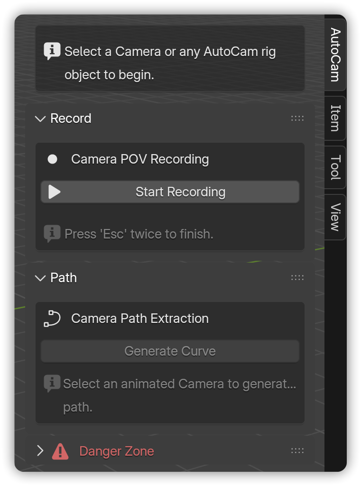

# UI Overview

This page provides a quick overview of the layout, explains the purpose of each panel, and describes how they respond in various contexts.

Think of it as a map- start here to understand where everything lives, then jump into the dedicated pages for each panel.

&#x20;

***

&#x20;

## Introduction


{% column width="58.333333333333336%" %}

<figure><figcaption></figcaption></figure>



{% column width="41.666666666666664%" valign="middle" %}
The AutoCam interface lives in\
**3D View** → **N-panel** → **AutoCam**.



&#x20;

***

&#x20;

## Header States

The top of the AutoCam panel is an unlabelled box that always tells you what you're working on.

* **Nothing relevant selected** - "Select a Camera or any AutoCam rig object to begin."
* **A plain camera selected** - Its name and whether it's **active** or **inactive**. If it's inactive, a **Make Active** button appears to make it the scene camera.
* **An AutoCam object selected** - "Selected Rig: _name_", so you always know which rig the panels below are editing.


**Make Active** lives here, at the top, not on the Source panel. Recording always uses the **active scene camera**, so this is the button you press before recording.


&#x20;

***

&#x20;

## Panel States

Panels within the AutoCam interface dynamically update based on the context, similar to the header.

&#x20;

### **Source** panel:


{% column width="50%" valign="middle" %}
Shown for everything except a **baked** camera.

With a plain camera or nothing selected, it offers **Record Flythrough**.


{% column width="50%" valign="middle" %}
<figure><figcaption></figcaption></figure>




[Learn more](source.md) about **Record Flythrough**.



{% column width="50%" valign="middle" %}
With an AutoCam object selected, it switches to naming the camera that rig's motion came from, so Source doubles as "where did this shot come from".


{% column width="50%" valign="middle" %}
<figure><figcaption></figcaption></figure>




{% column width="50%" valign="middle" %}
If that camera is no longer in the file, it reads **Source removed**. The rig still works - its camera is an independent copy.


{% column width="50%" valign="middle" %}
<figure><figcaption></figcaption></figure>



&#x20;

***

&#x20;

### **Path** panel:


{% column width="50%" valign="middle" %}
When the selected object is a non-camera object, the **Path** panel prompts the user to select an animated camera.


{% column width="50%" valign="middle" %}
<figure><figcaption></figcaption></figure>



***



If a camera is selected, but it lacks animation data, it updates the prompt.



<figure><figcaption></figcaption></figure>



***



When you select an animated camera, **Generate Curve** is enabled and the prompt is hidden.



<figure><figcaption></figcaption></figure>



***



When an AutoCam object is selected, **Path Settings** appears instead.


[Learn more](path.md) about **Path Settings**.




<figure><figcaption></figcaption></figure>



&#x20;

***

&#x20;

### **Rig Settings** panel:



Before the rig exists, the **Rig** panel offers **Generate Rig** (an AutoCam curve must be selected).



<figure><figcaption></figcaption></figure>



***



Once built, it becomes the rig's settings: the **Progress** slider with its keyframe decorator, the **Show Path Direction** checkbox, and a collapsible **Tracking** sub-panel.


[Learn more](rig.md) about **Rig Settings**.




<figure><figcaption></figcaption></figure>



***

&#x20;

### **Output** panel:



Collapsed by default.

Holds **Bake** and its settings popover.




<figure><figcaption></figcaption></figure>






Once a bake exists, the button reads **Re-Bake.**



<figure><figcaption></figcaption></figure>





Run it again with different settings without rebuilding the rig.



<figure><figcaption></figcaption></figure>



&#x20;

***

&#x20;&#x20;

### **Danger Zone** panel:



Collapsed by default, and only present when **Show 'Danger Zone'** is on in Preferences.




<figure><figcaption></figcaption></figure>






**Clear This Rig**: Removes the selected rig and its baked camera, restores the original camera, leaves every other rig alone. Greyed out until a rig is selected.



<figure><figcaption></figcaption></figure>





**Clear All Rigs**: Removes ALL AutoCam rigs; scene-wide.



<figure><figcaption></figcaption></figure>



&#x20;

***

## User Preferences

Access AutoCam’s user preferences to change the default settings:\
**Edit** → **Preferences** → **Add-ons** → **AutoCam** → expand to see user preferences.

Preferences affect **new** rigs/paths you create; they don’t retroactively change existing ones.


**Tip:**

*
  **Show 'Danger Zone':** Shows or hides the destructive-tools panel.
* **Show Hints:** Hides the instructional text in the panels once you know the workflow. Warnings, errors, and computed values always stay visible.
* **Flythrough Controls:** Look sensitivity, move speed, fast multiplier, and rebindable movement keys with a one-click AZERTY (ZQSD) preset.


***

&#x20;

## Next steps

* **Learn each feature in depth** → [**Source**](source.md) **-** [**Path**](path.md) **-** [**Rig**](rig.md) **-** [**Output**](output.md)
* **See practical examples** → [**Guides**](../guides.md)
* **Having issues?** Start with [**Troubleshooting**](../../help/troubleshooting.md), check the [**FAQ**](../../help/faq.md), and contact [**Support**](../../help/support.md) if necessary.

&#x20;
