# UI Overview

This page provides a quick overview of the layout, explains the purpose of each panel, and describes how they respond in various contexts.

Think of it as a map- start here to understand where everything lives, then jump into the dedicated pages for each panel.


Anything marked <mark style="color:$warning;">**PRO**</mark> is an **AutoCam Pro** feature and is not present in a Free install.


***

### Introduction


{% column width="58.333333333333336%" %}
<figure>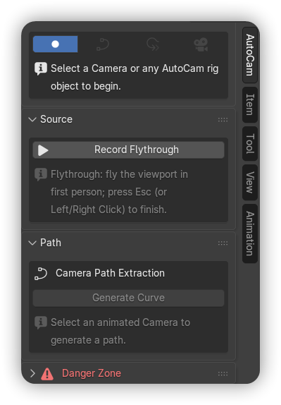<figcaption></figcaption></figure>


{% column width="41.666666666666664%" valign="middle" %}
The AutoCam interface lives in\
**3D View** → **N-panel** → **AutoCam**.



***

### The stage breadcrumb

At the very top of the sidebar sits a strip of four icons: **Source · Path · Rig · Output**. It is the masthead in both editions, and it is the legend for everything below it.

<figure>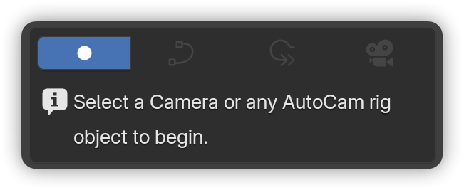<figcaption></figcaption></figure>

AutoCam's panels are contextual - they appear and disappear based on what you have selected and how far along the shot is. The breadcrumb tells you _why_: it marks which stage the current selection has reached, so a panel that isn't on screen reads as "not yet" rather than "missing".

<table><thead><tr><th width="143.60009765625">Stage</th><th>What it covers</th></tr></thead><tbody><tr><td><strong>Source</strong></td><td>Where the camera motion comes from: record a flythrough or create a camera morph</td></tr><tr><td><strong>Path</strong></td><td>Generate an editable path curve from the source camera's motion</td></tr><tr><td><strong>Rig</strong></td><td>Build the camera rig that travels the path; author speed and tracking</td></tr><tr><td><strong>Output</strong></td><td>Bake the rig into a final, portable camera</td></tr></tbody></table>


**Tip:** Hover any icon for its description. The strip is a status display in Free; in Pro, each rig's row in the **Pipeline** list carries its own clickable version of the same four cells.


***

### Header States

Below the breadcrumb, the same box always tells you what you're working on.

* **Nothing relevant selected** - "Select a Camera or any AutoCam rig object to begin."\
  
* **A plain camera selected** - Its name and whether it's **active** or **inactive**. If it's inactive, a **Make Active** button appears to make it the scene camera.\
  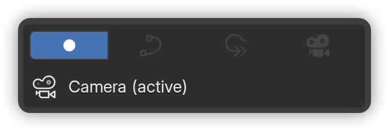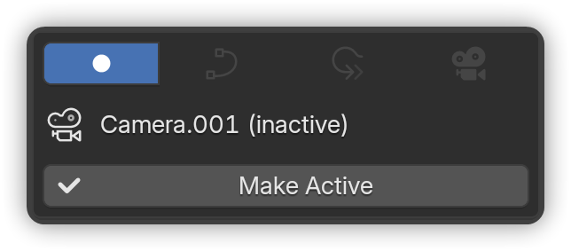
* **An AutoCam object selected** - "Selected Rig: _name_", so you always know which rig the panels below are editing.\
  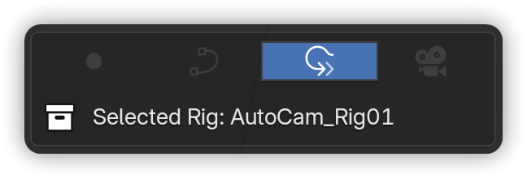


**Make Active** lives here, at the top, not on the Source panel. Recording always uses the **active scene camera**, so this is the button you press before recording.


***

### Pipeline <mark style="color:$warning;">**PRO**</mark>

In AutoCam Pro, the header box grows a list of **every rig in the scene**, stacked under the breadcrumb. This is the Pipeline: one place to see, switch, and manage every camera move in the file.

<figure>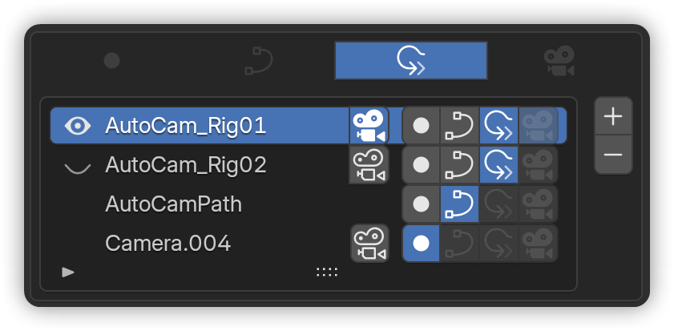<figcaption></figcaption></figure>

Each row carries:

* **Viewport eye** - Hides that rig's collection. It keeps animating; it just stops cluttering the view.
* **Rig name** - **Double-click to rename**. The new name cascades to the collections, the curve, and every object in the rig.
* **Scene camera toggle** - Which rig actually renders.
* **A four-cell stage strip** - Source · Path · Rig · Output. The rig's current stage is pressed in; stages it can't reach yet are ghosted.

Selecting a row highlights the rig in the viewport, and selecting a rig in the viewport highlights its row.

#### Revert and restore

The stage strip is clickable, and that's the point: a rig can move back down its own pipeline and climb back up without losing work.

* **Click an earlier stage to revert.** A confirm dialog spells out exactly what gets deleted. **Ctrl+Z** undoes it.
* **Click a later stage to restore.** AutoCam rebuilds it **exactly** as it was - curve edits, hand-keyed Progress, tracking mode, even the bake's own settings.

Snapshots are recorded automatically on every revert, so you never have to decide in advance whether to keep a stage. Parameters like tracking mode, Loop, and Segments survive reverts untouched.


**Tip:** Reverting to **Path**, reshaping the curve, then clicking back up to **Rig** is the fastest way to change a move's route without rebuilding it by hand.


#### Side rail

* **+ Add Camera** - Drops a new camera at the current viewport view, stamps it, and lists it, ready to record.
* **− Delete Rig** - Removes one rig completely, including its source camera. Confirms first.

***

### Panel States

Panels within the AutoCam interface dynamically update based on the context, similar to the header.

#### **Source** panel:


{% column width="50%" valign="middle" %}
Shown for everything except a **baked** camera.

With a plain camera or nothing selected, it offers **Record Flythrough**.


{% column width="50%" valign="middle" %}
<figure>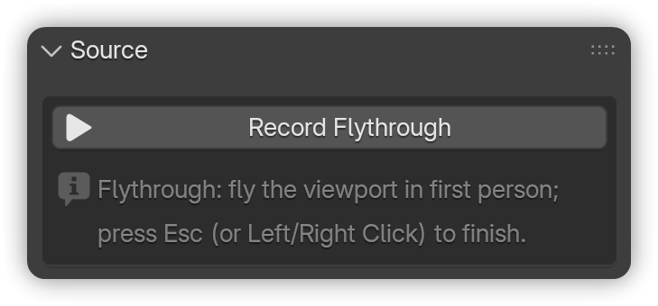<figcaption></figcaption></figure>




Learn more about [**Record Flythrough**](source.md#start-a-recording).



{% column width="50%" valign="middle" %}
With an AutoCam object selected, it switches to naming the camera that rig's motion came from, so Source doubles as "where did this shot come from".


{% column width="50%" valign="middle" %}
<figure>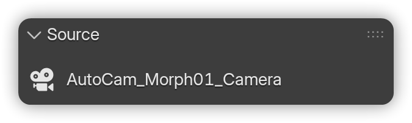<figcaption></figcaption></figure>




{% column width="50%" valign="middle" %}
If that camera is no longer in the file, it reads **Source removed**. The rig still works - its camera is an independent copy.


{% column width="50%" valign="middle" %}
<figure>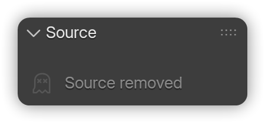<figcaption></figcaption></figure>




<mark style="color:$warning;">**PRO**</mark> Source also carries **New Camera Morph** next to Record Flythrough, and a **Camera Morph** sub-panel once one exists. [Learn more](source.md#camera-morph-pro).\
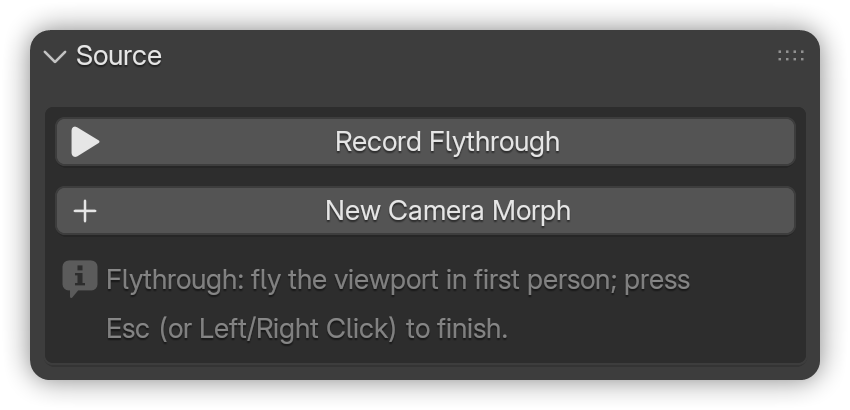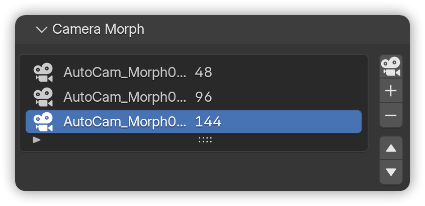


***

#### **Path** panel:


{% column width="50%" valign="middle" %}
When the selected object is a non-camera object, the **Path** panel prompts the user to select an animated camera.


{% column width="50%" valign="middle" %}
<figure>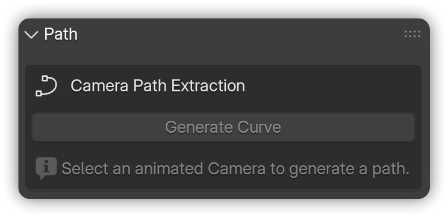<figcaption></figcaption></figure>



***



If a camera is selected, but it lacks animation data, it updates the prompt.



<figure>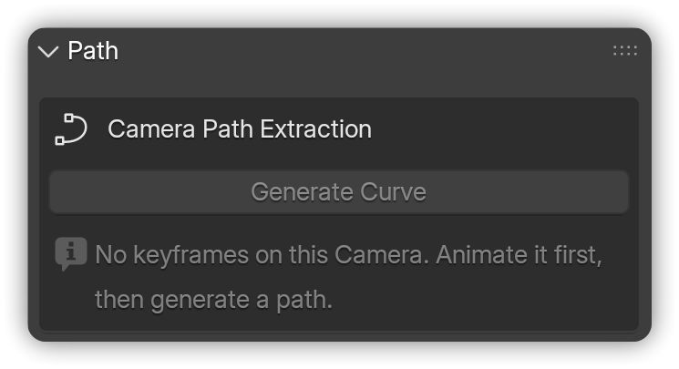<figcaption></figcaption></figure>



***



When you select an animated camera, **Generate Curve** is enabled and the prompt is hidden.



<figure>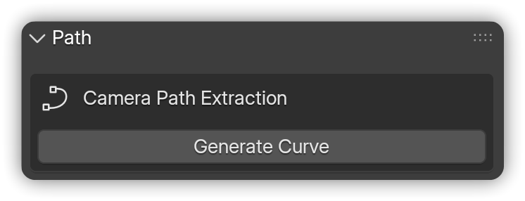<figcaption></figcaption></figure>



***



When an AutoCam object is selected, **Path Settings** appears instead.


Learn more about [**Path Settings**](path.md).




<figure>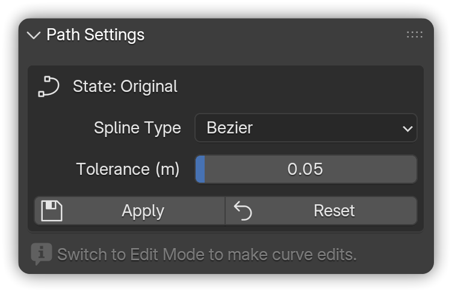<figcaption></figcaption></figure>




<mark style="color:$warning;">**PRO**</mark> Path gains two sub-panels: **Loop** and **Steering**. [Learn more](path.md).\
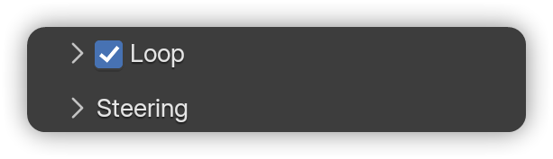


***

#### **Rig Settings** panel:



Before the rig exists, the **Rig** panel offers **Generate Rig** (an AutoCam curve must be selected).



<figure>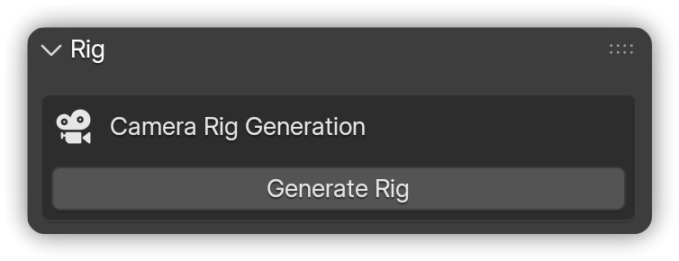<figcaption></figcaption></figure>



***



Once built, it becomes the rig's settings: the **Progress** slider with its keyframe decorator, and a collapsible **Tracking** sub-panel.


Learn more about **Rig Settings**.




<figure>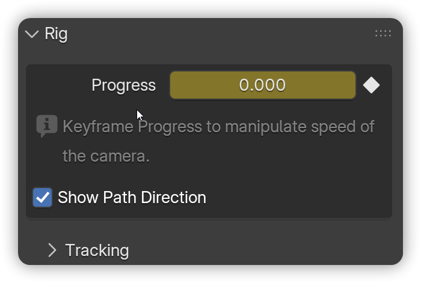<figcaption></figcaption></figure>




**Moved in 2.1.1:** **Show Path Direction** used to be a checkbox here. It is now a global setting in **Preferences → Viewport**, alongside **Rig Scale**.



<mark style="color:$warning;">**PRO**</mark> Rig also carries **Inherit Original Speed** inline, three extra **Tracking** modes, and a **Segments** sub-panel. [Learn more](rig.md).\
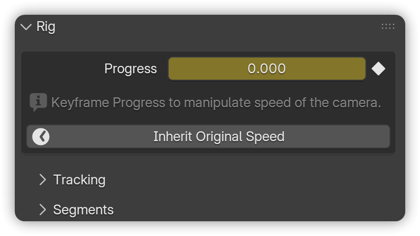


***

#### **Output** panel:



Collapsed by default.

Holds **Bake** and its settings popover.



<figure>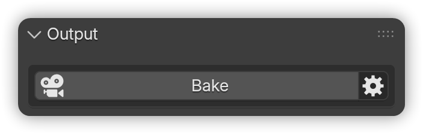<figcaption></figcaption></figure>





Once a bake exists, the button reads **Re-Bake.**



<figure>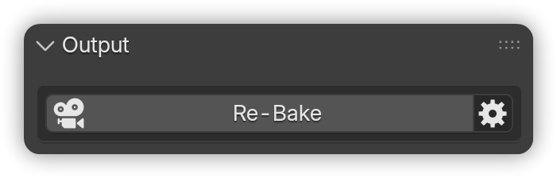<figcaption></figcaption></figure>





Run it again with different settings without rebuilding the rig.



<figure>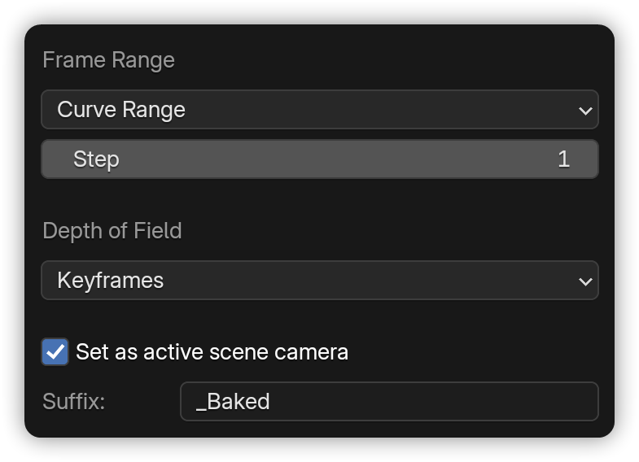<figcaption></figcaption></figure>




<mark style="color:$warning;">**PRO**</mark> Output gains a **Batch** sub-panel (once two or more rigs exist) and an **Export** sub-panel. [Learn more](output.md).\
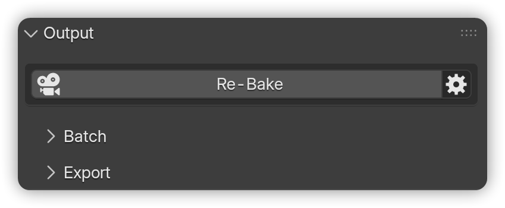


***

#### **Danger Zone** panel:



Collapsed by default, and only present when **Show 'Danger Zone'** is on in Preferences.



<figure><figcaption></figcaption></figure>





**Clear This Rig**: Removes the selected rig and its baked camera, restores the original camera, leaves every other rig alone. Greyed out until a rig is selected.



<figure>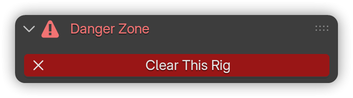<figcaption></figcaption></figure>





**Clear All Rigs**: Removes ALL AutoCam rigs; scene-wide.



<figure>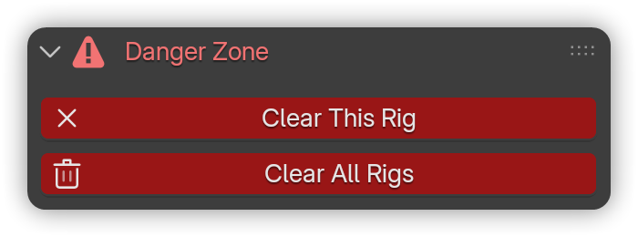<figcaption></figcaption></figure>



***

### User Preferences

Access AutoCam's user preferences to change the default settings:\
**Edit** → **Preferences** → **Add-ons** → **AutoCam** → expand to see user preferences.

<figure>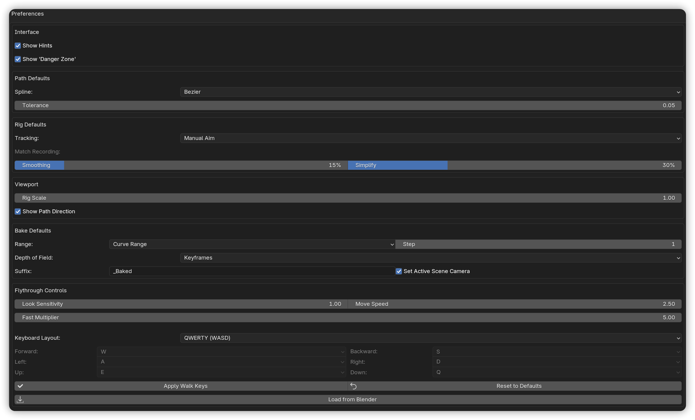<figcaption></figcaption></figure>

Preferences are grouped into seven boxes.

#### Interface

| Setting                                                                                                         | What it does                                                                                                                      |
| --------------------------------------------------------------------------------------------------------------- | --------------------------------------------------------------------------------------------------------------------------------- |
| <ul class="contains-task-list"><li><input type="checkbox" checked><strong>Show Hints</strong></li></ul>         | Hides the instructional text in the panels once you know the workflow. Warnings, errors, and computed values always stay visible. |
| <ul class="contains-task-list"><li><input type="checkbox" checked><strong>Show 'Danger Zone'</strong></li></ul> | Shows or hides the destructive-tools panel.                                                                                       |

#### Path Defaults

| Setting       | What it does                                                           |
| ------------- | ---------------------------------------------------------------------- |
| **Spline**    | Which spline type new curves are generated as: Bezier, Poly, or NURBS. |
| **Tolerance** | Default simplification for new curves. Higher = fewer points.          |

#### Rig Defaults

| Setting                      | What it does                                                                                                                                                     |
| ---------------------------- | ---------------------------------------------------------------------------------------------------------------------------------------------------------------- |
| **Tracking**                 | Which tracking mode new rigs start in. Free offers **Manual Aim** and **Match Recording**; <mark style="color:$warning;">**PRO**</mark> adds **Path Lookahead**. |
| **Smoothing** / **Simplify** | Seeded onto every new rig, but only **Match Recording** has anything to smooth - the panel labels them accordingly.                                              |


<mark style="color:$warning;">**PRO**</mark> **Path Lookahead** is the only Pro aim mode that can be a default. **Lock to Target** needs a target object and **Smart Auto-Aim** needs a recording to resample, and neither exists at the moment a rig is built.


#### Viewport

| Setting                 | What it does                                                                                                          |
| ----------------------- | --------------------------------------------------------------------------------------------------------------------- |
| **Rig Scale**           | Multiplies every rig handle's size. Handle sizes are derived from the path, which suits most shots but not every one. |
| **Show Path Direction** | Draws the path as a soft accent line with chevrons pointing the way the camera travels.                               |


**These two are global and live.** Unlike the Defaults boxes, they are not "seeded onto new rigs" - moving **Rig Scale** resizes the handles on **every rig in the file immediately**, and **Show Path Direction** applies to all rigs at once. Prior to 2.1.1, Show Path Direction was a per-rig checkbox; that distinction is gone.


#### Bake Defaults

Seeds a new scene's **Bake Settings**: **Range**, **Step**, **Depth of Field**, **Suffix**, and **Set Active Scene Camera**. See [**Output**](output.md) for what each one does.

#### Flythrough Controls

Look sensitivity, move speed, fast multiplier, and rebindable movement keys with a one-click **AZERTY (ZQSD)** preset. Covered in full on [**Source**](source.md).

#### About

Names the **edition and version** you're running - _AutoCam Free 2.1.1_ or _AutoCam Pro 1.0.0_ - with links to this documentation, the website, and support. This is the fastest way to confirm which edition is installed.


**Rule of thumb:** the **Defaults** boxes (Path, Rig, Bake) affect **new** rigs, paths and scenes only - they don't retroactively change existing ones. The **Viewport** box applies to everything, immediately.


***

## Next steps

* **Learn each feature in depth** → [**Source**](source.md) **-** [**Path**](path.md) **-** [**Rig**](rig.md) **-** [**Output**](output.md)
* **See practical examples** → [**Guides**](../guides.md)
* **Having issues?** Start with [**Troubleshooting**](../../help/troubleshooting.md), check the [**FAQ**](../../help/faq.md), and contact [**Support**](../../help/support.md) if necessary.

&#x20;
